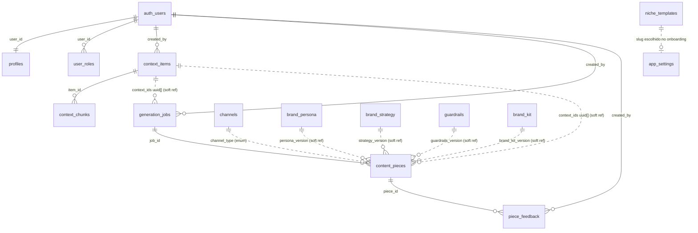

# Modelo de Dados (Supabase, single-tenant)

Este documento especifica o modelo de dados completo do Content Engine: princípios, entidades, DDL SQL idempotente (enums, tabelas, índices, triggers, funções, RLS), documentação dos schemas `jsonb`, buckets de Storage, extensões, seeds de fábrica, uso do Vault e estratégia de migrations. Ele materializa o §6 do brief canônico e é a referência de banco para 05-rotas-e-modulos.md, 06-arquitetura-ia.md, 07-contratos-backend.md e 09-plano-implementacao.md. A visão de produto está em 01-visao-produto.md e o escopo em 02-escopo-mvp.md.

---

## 1. Princípios

| Princípio | Decisão |
|---|---|
| **Single-tenant físico** | Cada cliente tem seu próprio projeto Lovable + Supabase (provisionado por Remix, ver 08-estrategia-template.md). O isolamento é físico: **NUNCA escrever `tenant_id`** em nenhuma tabela. |
| **RLS só para papéis internos** | RLS habilitada em todas as tabelas, mas serve APENAS para auth e papéis dentro da instância (`admin` vs `user`). Papéis via `has_role()` SECURITY DEFINER — padrão Lovable; **NUNCA** coluna `role` em `profiles`. |
| **Versionamento append-only** | `brand_persona`, `brand_strategy`, `guardrails` e `brand_kit` nunca sofrem UPDATE de conteúdo ativo: editar cria nova linha `draft` (`version + 1`); ativar arquiva a anterior. Sempre exatamente uma linha `active` (índice único parcial). Peças carimbam as versões usadas. |
| **`jsonb` para conteúdo flexível** | Conteúdo editorial (persona, estratégia, guardrails, brand kit, core/adapted content, auditoria) vive em `jsonb` com **schema documentado neste doc** (§8) e validado no código do motor — o banco não impõe shape, o motor sim. |
| **Motor vs Recheio** | Estrutura (tabelas, enums, seeds de `niche_templates`/`channels`) é motor e vem por migration. Dados do cliente (recheio) entram só via onboarding e uso — o template não contém dado de cliente algum. |
| **Convenções** | `snake_case`; `id uuid pk default gen_random_uuid()`; `created_at`/`updated_at timestamptz`; escrita de negócio via Edge Functions (service role, bypassa RLS); cliente escreve direto apenas onde a política permite. |

---

## 2. Diagrama de entidades e relações



Legenda: linhas cheias = FK física; pontilhadas = referência lógica (enum, versão carimbada ou array de uuids — sem FK para não travar o append-only nem impedir arquivamento).

Resumo por domínio:

| Domínio | Tabelas | Papel |
|---|---|---|
| Identidade e acesso | `profiles`, `user_roles` | Perfil do usuário e papéis (`admin`/`user`), first-user-admin |
| Configuração | `app_settings`, `niche_templates`, `channels` | Chave-valor da instância, presets de fábrica, canais/adapters |
| Cérebro da marca (versionadas) | `brand_persona`, `brand_strategy`, `guardrails`, `brand_kit` | Contrato de voz, bandeira/teses/ICP, regras duras, identidade visual |
| Conteúdo de Contexto (RAG) | `context_items`, `context_chunks` | Base de conhecimento + chunks com embedding |
| Geração | `generation_jobs`, `content_pieces` | Saga de geração (máquina de estados) e peças por canal |
| Feedback | `piece_feedback` | Vereditos humanos (incl. gate de tom) para calibração futura |
| P1 (feature) | `editorial_state` | Singleton anti-repetição (tabela criada na F0; feature P1) |

---

## 3. Extensões

```sql
-- Migration: extensões necessárias (idempotente)
create extension if not exists vector with schema extensions;  -- pgvector: embeddings
create extension if not exists pg_cron;                        -- watchdog de jobs travados
create extension if not exists pg_net;                         -- watchdog chama resume-job via HTTP
```

Notas:
- `vector` é obrigatória (RAG do Conteúdo de Contexto). No Supabase a extensão vai para o schema `extensions`, que já está no `search_path` — o DDL usa `vector(768)` sem qualificar.
- `pg_cron` + `pg_net` suportam o watchdog que re-invoca `resume-job` para jobs travados (>N min sem update — ver 07-contratos-backend.md, fase F5 em 09-plano-implementacao.md).
- `pgcrypto`/`gen_random_uuid()` já é nativo no Postgres do Supabase.

---

## 4. Enums

```sql
-- Migration: tipos enum (idempotente via bloco DO)
do $$ begin
  create type public.app_role as enum ('admin', 'user');
exception when duplicate_object then null; end $$;

do $$ begin
  create type public.channel_type as enum (
    'instagram_stories',
    'instagram_carousel',
    'instagram_post',
    'x_post',
    'threads_post',
    'linkedin_post',
    'facebook_post'
  );
exception when duplicate_object then null; end $$;

do $$ begin
  create type public.context_kind as enum (
    'transcript', 'post', 'document', 'reference', 'case', 'offer'
  );
exception when duplicate_object then null; end $$;

do $$ begin
  create type public.job_status as enum (
    'created', 'classifying', 'awaiting_angle', 'retrieving', 'generating',
    'linting', 'grounding', 'judging', 'rewriting', 'adapting',
    'awaiting_review', 'done', 'failed', 'cancelled'
  );
exception when duplicate_object then null; end $$;

do $$ begin
  create type public.piece_status as enum (
    'draft', 'approved', 'rejected', 'archived'
  );
exception when duplicate_object then null; end $$;
```

Canal novo no futuro = `alter type public.channel_type add value if not exists '<novo>';` em migration aditiva + novo adapter + linha em `channels` (ver 08-estrategia-template.md). Estados de tabela versionada (`draft`/`active`/`archived`) e status de ingestão (`processing`/`ready`/`error`) usam `text + check`, conforme o brief — não são enums nomeados.

O mesmo padrão aditivo já foi exercitado no `job_status`: a migration `202607310015_web_research_and_slide_images.sql` adicionou o valor **`'researching'`** (`alter type public.job_status add value if not exists 'researching' after 'retrieving';`) — etapa de pesquisa web reativa da saga (06-arquitetura-ia.md §5.4). O DDL de criação acima permanece o da F0; o enum vigente inclui `researching` entre `retrieving` e `generating`.

---

## 5. Funções e triggers de base

### 5.1 `set_updated_at` (trigger genérico)

```sql
create or replace function public.set_updated_at()
returns trigger
language plpgsql
set search_path = public
as $$
begin
  new.updated_at = now();
  return new;
end;
$$;
```

Aplicado a toda tabela com `updated_at` (DDL de cada tabela repete o par `drop trigger if exists` + `create trigger`).

### 5.2 `has_role` (SECURITY DEFINER — padrão Lovable)

```sql
create or replace function public.has_role(_user_id uuid, _role public.app_role)
returns boolean
language sql
stable
security definer
set search_path = public
as $$
  select exists (
    select 1
    from public.user_roles
    where user_id = _user_id
      and role = _role
  );
$$;
```

Regras de ouro (padrão Lovable, inegociáveis):
- Papel **nunca** em coluna de `profiles` — sempre em `user_roles`.
- Políticas RLS **nunca** consultam `user_roles` diretamente (recursão de RLS) — sempre via `has_role()` SECURITY DEFINER.
- A função é `stable` para o planner poder cachear dentro da query.

### 5.3 `handle_new_user` (first-user-admin)

```sql
create or replace function public.handle_new_user()
returns trigger
language plpgsql
security definer
set search_path = public
as $$
declare
  _invited_role text;
begin
  -- Serializa a decisão "primeiro usuário" contra signups concorrentes
  perform pg_advisory_xact_lock(hashtext('handle_new_user_first_admin'));

  insert into public.profiles (user_id, display_name, avatar_url)
  values (
    new.id,
    coalesce(new.raw_user_meta_data ->> 'display_name', split_part(new.email, '@', 1)),
    new.raw_user_meta_data ->> 'avatar_url'
  )
  on conflict (user_id) do nothing;

  if not exists (select 1 from public.user_roles where role = 'admin') then
    -- Primeiro usuário do banco vira admin (primeiro acesso pós-Remix)
    insert into public.user_roles (user_id, role) values (new.id, 'admin')
    on conflict (user_id, role) do nothing;
  else
    -- Já existe admin: só entra quem veio por convite (invite-user grava o papel
    -- do convidado em raw_user_meta_data.role)
    _invited_role := new.raw_user_meta_data ->> 'role';

    if _invited_role is null then
      -- Signup direto sem metadata de convite: bloqueado
      raise exception 'signup direto desabilitado: novos usuários entram apenas por convite de um admin';
    end if;

    if _invited_role not in ('admin', 'user') then
      -- Valida contra o enum app_role antes do cast
      raise exception 'papel de convite inválido: %', _invited_role;
    end if;

    insert into public.user_roles (user_id, role)
    values (new.id, _invited_role::public.app_role)
    on conflict (user_id, role) do nothing;
  end if;

  return new;
end;
$$;

drop trigger if exists on_auth_user_created on auth.users;
create trigger on_auth_user_created
  after insert on auth.users
  for each row execute function public.handle_new_user();
```

Casa com a regra de auth do 05-rotas-e-modulos.md: signup aberto apenas enquanto não existe admin (primeiro acesso pós-Remix); depois, novos usuários SÓ por convite — `invite-user` (ver 07-contratos-backend.md) grava o papel do convidado em `raw_user_meta_data.role`, o trigger valida esse papel contra o enum `app_role` e o atribui; signup direto sem metadata de convite falha com `raise exception`. O frontend /login esconde o signup quando `has_any_admin()` retorna `true` (§5.4).

### 5.4 `has_any_admin` (SECURITY DEFINER — exposta a `anon`)

```sql
create or replace function public.has_any_admin()
returns boolean
language sql
stable
security definer
set search_path = public
as $$
  select exists (select 1 from public.user_roles where role = 'admin');
$$;

revoke all on function public.has_any_admin() from public;
grant execute on function public.has_any_admin() to anon, authenticated;
```

Usada pelo /login para decidir se mostra o signup (só enquanto não existe admin). O `GRANT EXECUTE` a `anon` é uma **exceção consciente e documentada** à invariante "nada exposto a anon" do §7: a função retorna apenas um boolean de existência de admin — nenhum dado de usuário, papel ou identificador vaza.

---

## 6. DDL por tabela (com índices e RLS)

Todas as tabelas: `alter table ... enable row level security;`. Políticas seguem o padrão `drop policy if exists` + `create policy` (idempotente). Edge Functions escrevem com **service role** (bypassa RLS) — as políticas abaixo governam apenas o acesso direto do client (PostgREST/`supabase-js`).

### 6.1 `profiles`

```sql
create table if not exists public.profiles (
  id uuid primary key default gen_random_uuid(),
  user_id uuid not null unique references auth.users(id) on delete cascade,
  display_name text,
  avatar_url text,
  created_at timestamptz not null default now(),
  updated_at timestamptz not null default now()
);

drop trigger if exists trg_profiles_updated_at on public.profiles;
create trigger trg_profiles_updated_at
  before update on public.profiles
  for each row execute function public.set_updated_at();

alter table public.profiles enable row level security;

-- Time da instância se enxerga (single-tenant, sem dados sensíveis no perfil)
drop policy if exists "profiles_select_authenticated" on public.profiles;
create policy "profiles_select_authenticated"
  on public.profiles for select
  to authenticated
  using (true);

-- Cada um edita o próprio perfil
drop policy if exists "profiles_update_own" on public.profiles;
create policy "profiles_update_own"
  on public.profiles for update
  to authenticated
  using (user_id = auth.uid())
  with check (user_id = auth.uid());

-- INSERT: apenas via trigger handle_new_user (SECURITY DEFINER) — sem política de insert para o client
```

### 6.2 `user_roles`

```sql
create table if not exists public.user_roles (
  id uuid primary key default gen_random_uuid(),
  user_id uuid not null references auth.users(id) on delete cascade,
  role public.app_role not null,
  created_at timestamptz not null default now(),
  unique (user_id, role)
);

alter table public.user_roles enable row level security;

-- Usuário vê os próprios papéis; admin vê todos
drop policy if exists "user_roles_select_own_or_admin" on public.user_roles;
create policy "user_roles_select_own_or_admin"
  on public.user_roles for select
  to authenticated
  using (user_id = auth.uid() or public.has_role(auth.uid(), 'admin'));

-- Somente admin gerencia papéis (convites/promoções via /config/usuarios)
drop policy if exists "user_roles_admin_all" on public.user_roles;
create policy "user_roles_admin_all"
  on public.user_roles for all
  to authenticated
  using (public.has_role(auth.uid(), 'admin'))
  with check (public.has_role(auth.uid(), 'admin'));
```

Salvaguarda "não remover o último admin" fica na camada de aplicação (`/config/usuarios` + `invite-user`), não no banco (proposta — validar).

### 6.3 `app_settings`

```sql
create table if not exists public.app_settings (
  key text primary key,
  value jsonb not null default '{}'::jsonb,
  created_at timestamptz not null default now(),
  updated_at timestamptz not null default now()
);

drop trigger if exists trg_app_settings_updated_at on public.app_settings;
create trigger trg_app_settings_updated_at
  before update on public.app_settings
  for each row execute function public.set_updated_at();

alter table public.app_settings enable row level security;

-- Leitura autenticada (frontend precisa de flags, progresso do onboarding, providers)
drop policy if exists "app_settings_select_authenticated" on public.app_settings;
create policy "app_settings_select_authenticated"
  on public.app_settings for select
  to authenticated
  using (true);

-- Escrita admin
drop policy if exists "app_settings_admin_write" on public.app_settings;
create policy "app_settings_admin_write"
  on public.app_settings for all
  to authenticated
  using (public.has_role(auth.uid(), 'admin'))
  with check (public.has_role(auth.uid(), 'admin'));
```

Guarda: providers/modelos por papel de IA, flags, progresso do onboarding, defaults do engine (schemas em §8.9). Segredos **NUNCA** aqui — vão para o Vault (§11).

### 6.4 `niche_templates`

```sql
create table if not exists public.niche_templates (
  id uuid primary key default gen_random_uuid(),
  slug text not null unique,
  name text not null,
  description text,
  payload jsonb not null default '{}'::jsonb,
  created_at timestamptz not null default now(),
  updated_at timestamptz not null default now()
);

drop trigger if exists trg_niche_templates_updated_at on public.niche_templates;
create trigger trg_niche_templates_updated_at
  before update on public.niche_templates
  for each row execute function public.set_updated_at();

alter table public.niche_templates enable row level security;

-- Dado de fábrica (motor): leitura autenticada, escrita SÓ por migration/service role
drop policy if exists "niche_templates_select_authenticated" on public.niche_templates;
create policy "niche_templates_select_authenticated"
  on public.niche_templates for select
  to authenticated
  using (true);
-- Sem políticas de escrita para o client: populada por MIGRATION (seeds em §12)
```

### 6.5 Tabelas versionadas: `brand_persona`, `brand_strategy`, `guardrails`, `brand_kit`

Shape comum (append-only): `version int` sequencial, `status text check in ('draft','active','archived')`, **uma** linha `active` garantida por índice único parcial. Fluxo: editar → nova linha `draft` com `version = max(version) + 1` → "ativar" muda a `active` atual para `archived` e o draft para `active` (transação na Edge Function / mutação de /marca — ver 05-rotas-e-modulos.md).

```sql
-- brand_persona: contrato de voz (9 seções — schema em §8.1)
create table if not exists public.brand_persona (
  id uuid primary key default gen_random_uuid(),
  version int not null,
  status text not null default 'draft' check (status in ('draft', 'active', 'archived')),
  content jsonb not null default '{}'::jsonb,
  created_by uuid references auth.users(id) on delete set null,
  created_at timestamptz not null default now(),
  updated_at timestamptz not null default now(),
  unique (version)
);
create unique index if not exists brand_persona_one_active
  on public.brand_persona (status) where status = 'active';

drop trigger if exists trg_brand_persona_updated_at on public.brand_persona;
create trigger trg_brand_persona_updated_at
  before update on public.brand_persona
  for each row execute function public.set_updated_at();

alter table public.brand_persona enable row level security;

drop policy if exists "brand_persona_select_authenticated" on public.brand_persona;
create policy "brand_persona_select_authenticated"
  on public.brand_persona for select to authenticated using (true);

drop policy if exists "brand_persona_admin_write" on public.brand_persona;
create policy "brand_persona_admin_write"
  on public.brand_persona for all to authenticated
  using (public.has_role(auth.uid(), 'admin'))
  with check (public.has_role(auth.uid(), 'admin'));
```

```sql
-- brand_strategy: bandeira/teses/ICP (schema em §8.2)
create table if not exists public.brand_strategy (
  id uuid primary key default gen_random_uuid(),
  version int not null,
  status text not null default 'draft' check (status in ('draft', 'active', 'archived')),
  content jsonb not null default '{}'::jsonb,
  created_by uuid references auth.users(id) on delete set null,
  created_at timestamptz not null default now(),
  updated_at timestamptz not null default now(),
  unique (version)
);
create unique index if not exists brand_strategy_one_active
  on public.brand_strategy (status) where status = 'active';

drop trigger if exists trg_brand_strategy_updated_at on public.brand_strategy;
create trigger trg_brand_strategy_updated_at
  before update on public.brand_strategy
  for each row execute function public.set_updated_at();

alter table public.brand_strategy enable row level security;

drop policy if exists "brand_strategy_select_authenticated" on public.brand_strategy;
create policy "brand_strategy_select_authenticated"
  on public.brand_strategy for select to authenticated using (true);

drop policy if exists "brand_strategy_admin_write" on public.brand_strategy;
create policy "brand_strategy_admin_write"
  on public.brand_strategy for all to authenticated
  using (public.has_role(auth.uid(), 'admin'))
  with check (public.has_role(auth.uid(), 'admin'));
```

```sql
-- guardrails: fonte única de regras duras (schema em §8.3)
create table if not exists public.guardrails (
  id uuid primary key default gen_random_uuid(),
  version int not null,
  status text not null default 'draft' check (status in ('draft', 'active', 'archived')),
  content jsonb not null default '{}'::jsonb,
  created_by uuid references auth.users(id) on delete set null,
  created_at timestamptz not null default now(),
  updated_at timestamptz not null default now(),
  unique (version)
);
create unique index if not exists guardrails_one_active
  on public.guardrails (status) where status = 'active';

drop trigger if exists trg_guardrails_updated_at on public.guardrails;
create trigger trg_guardrails_updated_at
  before update on public.guardrails
  for each row execute function public.set_updated_at();

alter table public.guardrails enable row level security;

drop policy if exists "guardrails_select_authenticated" on public.guardrails;
create policy "guardrails_select_authenticated"
  on public.guardrails for select to authenticated using (true);

drop policy if exists "guardrails_admin_write" on public.guardrails;
create policy "guardrails_admin_write"
  on public.guardrails for all to authenticated
  using (public.has_role(auth.uid(), 'admin'))
  with check (public.has_role(auth.uid(), 'admin'));
```

```sql
-- brand_kit: identidade visual (schema em §8.4)
create table if not exists public.brand_kit (
  id uuid primary key default gen_random_uuid(),
  version int not null,
  status text not null default 'draft' check (status in ('draft', 'active', 'archived')),
  content jsonb not null default '{}'::jsonb,
  created_by uuid references auth.users(id) on delete set null,
  created_at timestamptz not null default now(),
  updated_at timestamptz not null default now(),
  unique (version)
);
create unique index if not exists brand_kit_one_active
  on public.brand_kit (status) where status = 'active';

drop trigger if exists trg_brand_kit_updated_at on public.brand_kit;
create trigger trg_brand_kit_updated_at
  before update on public.brand_kit
  for each row execute function public.set_updated_at();

alter table public.brand_kit enable row level security;

drop policy if exists "brand_kit_select_authenticated" on public.brand_kit;
create policy "brand_kit_select_authenticated"
  on public.brand_kit for select to authenticated using (true);

drop policy if exists "brand_kit_admin_write" on public.brand_kit;
create policy "brand_kit_admin_write"
  on public.brand_kit for all to authenticated
  using (public.has_role(auth.uid(), 'admin'))
  with check (public.has_role(auth.uid(), 'admin'));
```

Escrita restrita a admin nas quatro tabelas de marca: configurar a marca é atribuição do perfil Administrador; o perfil Usuário consome (proposta — validar: se o dono quiser que usuários comuns editem /marca, trocar `has_role(auth.uid(),'admin')` por `true` nas políticas de escrita).

`created_by` nas versionadas é rastreabilidade de quem criou cada versão (proposta — validar; não listado no brief, custo zero e útil para auditoria interna).

### 6.6 `channels`

```sql
create table if not exists public.channels (
  id uuid primary key default gen_random_uuid(),
  type public.channel_type not null unique,
  enabled boolean not null default false,
  config jsonb not null default '{}'::jsonb,
  created_at timestamptz not null default now(),
  updated_at timestamptz not null default now()
);

drop trigger if exists trg_channels_updated_at on public.channels;
create trigger trg_channels_updated_at
  before update on public.channels
  for each row execute function public.set_updated_at();

alter table public.channels enable row level security;

drop policy if exists "channels_select_authenticated" on public.channels;
create policy "channels_select_authenticated"
  on public.channels for select to authenticated using (true);

-- Ativar/desativar canais e overrides: admin (onboarding passo 8 e /marca/canais)
drop policy if exists "channels_admin_write" on public.channels;
create policy "channels_admin_write"
  on public.channels for update to authenticated
  using (public.has_role(auth.uid(), 'admin'))
  with check (public.has_role(auth.uid(), 'admin'));
-- Sem insert/delete para o client: uma linha por canal, seed por migration (§12)
```

`config` guarda **overrides** por instância (limites, template, nota de corte); os defaults canônicos vivem no código do adapter (`_shared/adapters/` — ver 07-contratos-backend.md) e são espelhados no seed.

### 6.7 `context_items`

```sql
create table if not exists public.context_items (
  id uuid primary key default gen_random_uuid(),
  kind public.context_kind not null,
  title text not null,
  body text,
  source_url text,
  file_path text,                              -- ref no bucket context-files
  tags text[] not null default '{}',
  metadata jsonb not null default '{}'::jsonb, -- tipada p/ kind=case (§8.5)
  status text not null default 'processing' check (status in ('processing', 'ready', 'error')),
  created_by uuid references auth.users(id) on delete set null,
  created_at timestamptz not null default now(),
  updated_at timestamptz not null default now(),
  search tsvector generated always as (
    setweight(to_tsvector('portuguese', coalesce(title, '')), 'A') ||
    setweight(to_tsvector('portuguese', coalesce(body, '')), 'B')
  ) stored
);

create index if not exists context_items_search_idx
  on public.context_items using gin (search);
create index if not exists context_items_kind_idx
  on public.context_items (kind);
create index if not exists context_items_tags_idx
  on public.context_items using gin (tags);
create index if not exists context_items_status_idx
  on public.context_items (status);

drop trigger if exists trg_context_items_updated_at on public.context_items;
create trigger trg_context_items_updated_at
  before update on public.context_items
  for each row execute function public.set_updated_at();

alter table public.context_items enable row level security;

-- Conteúdo de Contexto é da instância inteira: todo autenticado lê
drop policy if exists "context_items_select_authenticated" on public.context_items;
create policy "context_items_select_authenticated"
  on public.context_items for select to authenticated using (true);

-- Cadastrar contexto é "usar a funcionalidade": qualquer usuário insere como si mesmo
drop policy if exists "context_items_insert_own" on public.context_items;
create policy "context_items_insert_own"
  on public.context_items for insert to authenticated
  with check (created_by = auth.uid());

-- Editar/remover: autor ou admin (proposta — validar)
drop policy if exists "context_items_update_own_or_admin" on public.context_items;
create policy "context_items_update_own_or_admin"
  on public.context_items for update to authenticated
  using (created_by = auth.uid() or public.has_role(auth.uid(), 'admin'))
  with check (created_by = auth.uid() or public.has_role(auth.uid(), 'admin'));

drop policy if exists "context_items_delete_own_or_admin" on public.context_items;
create policy "context_items_delete_own_or_admin"
  on public.context_items for delete to authenticated
  using (created_by = auth.uid() or public.has_role(auth.uid(), 'admin'));
```

Ciclo de vida: insert (`processing`) → Edge Function `ingest-context` limpa, chunka e embeda → `ready` (ou `error`, reprocessável). A coluna gerada `search` (tsvector português, título com peso A) é a metade full-text da busca híbrida (§5 do brief; retrieval em 06-arquitetura-ia.md).

### 6.8 `context_chunks`

```sql
create table if not exists public.context_chunks (
  id uuid primary key default gen_random_uuid(),
  item_id uuid not null references public.context_items(id) on delete cascade,
  chunk_index int not null,
  content text not null,
  embedding vector(768),   -- dimensão do modelo do gateway (google/gemini-embedding-001 com output_dimensionality=768)
  created_at timestamptz not null default now(),
  unique (item_id, chunk_index)
);

-- Índice vetorial: HNSW com distância de cosseno (preferido a ivfflat: não exige
-- treinamento prévio e mantém recall com a base crescendo — brief admite ambos)
create index if not exists context_chunks_embedding_idx
  on public.context_chunks using hnsw (embedding vector_cosine_ops);

create index if not exists context_chunks_item_idx
  on public.context_chunks (item_id);

alter table public.context_chunks enable row level security;

drop policy if exists "context_chunks_select_authenticated" on public.context_chunks;
create policy "context_chunks_select_authenticated"
  on public.context_chunks for select to authenticated using (true);
-- Sem políticas de escrita para o client: chunks são escritos SÓ pelo pipeline
-- ingest-context (service role)
```

Se o cliente trocar o modelo de embedding em /config/ia para um de dimensão diferente, é necessário reprocessar a base (re-ingestão) — a dimensão da coluna é fixa em 768; troca de dimensão é migration aditiva de nova coluna + backfill (proposta — validar, cenário pós-MVP).

Função de apoio ao retrieval (chamada pela ferramenta Retrieval com service role; a fusão híbrida vetor + tsvector + filtros está especificada em 06-arquitetura-ia.md) (proposta — validar):

```sql
create or replace function public.match_context_chunks(
  query_embedding vector(768),
  match_count int default 12,
  filter_kinds public.context_kind[] default null,
  filter_tags text[] default null
)
returns table (chunk_id uuid, item_id uuid, content text, similarity float)
language sql
stable
set search_path = public
as $$
  select c.id, c.item_id, c.content,
         1 - (c.embedding <=> query_embedding) as similarity
  from public.context_chunks c
  join public.context_items i on i.id = c.item_id
  where i.status = 'ready'
    and (filter_kinds is null or i.kind = any(filter_kinds))
    and (filter_tags is null or i.tags && filter_tags)
  order by c.embedding <=> query_embedding
  limit match_count;
$$;
```

### 6.9 `generation_jobs`

```sql
create table if not exists public.generation_jobs (
  id uuid primary key default gen_random_uuid(),
  prompt text not null,                        -- comando livre do usuário
  status public.job_status not null default 'created',
  classification jsonb,                        -- saída do roteador (§8.7)
  selected_angle jsonb,                        -- ângulo escolhido pelo humano (§8.7)
  context_ids uuid[] not null default '{}',    -- itens de contexto usados (soft ref)
  attempt int not null default 0,              -- reescritas (máx 2)
  error text,
  timings jsonb not null default '{}'::jsonb,  -- telemetria por etapa + totals (§8.7)
  created_by uuid references auth.users(id) on delete set null,
  created_at timestamptz not null default now(),
  updated_at timestamptz not null default now()
);

create index if not exists generation_jobs_status_idx
  on public.generation_jobs (status);
create index if not exists generation_jobs_created_by_idx
  on public.generation_jobs (created_by, created_at desc);
-- Watchdog: achar jobs travados (status intermediário + updated_at antigo)
create index if not exists generation_jobs_updated_at_idx
  on public.generation_jobs (updated_at);

drop trigger if exists trg_generation_jobs_updated_at on public.generation_jobs;
create trigger trg_generation_jobs_updated_at
  before update on public.generation_jobs
  for each row execute function public.set_updated_at();

alter table public.generation_jobs enable row level security;

drop policy if exists "generation_jobs_select_authenticated" on public.generation_jobs;
create policy "generation_jobs_select_authenticated"
  on public.generation_jobs for select to authenticated using (true);

-- Criação SEMPRE via edge function generate-content (service role).
-- Update direto do client: apenas dono ou admin, para cancelamento
-- (transições da saga são exclusivas das edge functions) (proposta — validar)
drop policy if exists "generation_jobs_update_own_or_admin" on public.generation_jobs;
create policy "generation_jobs_update_own_or_admin"
  on public.generation_jobs for update to authenticated
  using (created_by = auth.uid() or public.has_role(auth.uid(), 'admin'))
  with check (created_by = auth.uid() or public.has_role(auth.uid(), 'admin'));
```

Coluna adicionada pela migration `202607310015` (pesquisa web reativa — aditiva sobre o DDL da F0 acima):

```sql
alter table public.generation_jobs
  add column if not exists web_research jsonb;
-- Registro da etapa `researching`: {requested, provider, query, item_id, sources[],
-- searched_at, skipped?, error?} — shape WebResearch (§8.7; _shared/types.ts)
```

Máquina de estados (enum `job_status`): `created → classifying → [awaiting_angle →] retrieving → [researching →] generating → linting → grounding → judging → [rewriting → generating…] → adapting → awaiting_review → done`, com `failed` e `cancelled` como terminais alternativos (`researching` só roda quando `web_research.requested = true`). O frontend acompanha por **Realtime** (§10); jobs travados são retomados pelo watchdog via `resume-job` (07-contratos-backend.md).

### 6.10 `content_pieces`

```sql
create table if not exists public.content_pieces (
  id uuid primary key default gen_random_uuid(),
  job_id uuid not null references public.generation_jobs(id) on delete cascade,
  channel_type public.channel_type not null,
  core_content jsonb not null default '{}'::jsonb,     -- ideia + conteúdo núcleo (§8.6)
  adapted_content jsonb not null default '{}'::jsonb,  -- saída do adapter (§8.6)
  render_path text,                                    -- bucket renders (PNG quando houver)
  audit jsonb not null default '{}'::jsonb,            -- linter{}, grounding{}, judge{} (§8.8)
  status public.piece_status not null default 'draft',
  persona_version int,
  strategy_version int,
  guardrails_version int,
  brand_kit_version int,
  engine_version text,                                 -- ENGINE_VERSION (semver) carimbada
  context_ids uuid[] not null default '{}',
  created_at timestamptz not null default now(),
  updated_at timestamptz not null default now()
);

create index if not exists content_pieces_job_idx
  on public.content_pieces (job_id);
create index if not exists content_pieces_status_idx
  on public.content_pieces (status, created_at desc);
create index if not exists content_pieces_channel_idx
  on public.content_pieces (channel_type);

drop trigger if exists trg_content_pieces_updated_at on public.content_pieces;
create trigger trg_content_pieces_updated_at
  before update on public.content_pieces
  for each row execute function public.set_updated_at();

alter table public.content_pieces enable row level security;

drop policy if exists "content_pieces_select_authenticated" on public.content_pieces;
create policy "content_pieces_select_authenticated"
  on public.content_pieces for select to authenticated using (true);

-- Aprovar/rejeitar/arquivar na Biblioteca é funcionalidade de Usuário:
-- update liberado para autenticados (single-tenant, time pequeno) (proposta — validar)
drop policy if exists "content_pieces_update_authenticated" on public.content_pieces;
create policy "content_pieces_update_authenticated"
  on public.content_pieces for update to authenticated
  using (true)
  with check (true);

-- INSERT: só a saga (service role). DELETE: ninguém — descarte é status 'archived'
```

Coluna adicionada pela migration `202607310016_editorial_calendar.sql` (F5.4 — calendário editorial, entregue 2026-08-01):

```sql
alter table public.content_pieces
  add column if not exists scheduled_at timestamptz;
-- Data/hora alvo de publicação da peça APROVADA (null = sem agendamento).
-- Sem enum novo: status permanece 'approved'; a presença de scheduled_at marca
-- a peça como agendada. SEM auto-publish (F5.9 segue P2) — publicar é humano.

create index if not exists content_pieces_scheduled_idx
  on public.content_pieces (scheduled_at)
  where scheduled_at is not null;  -- visão de calendário busca por intervalo
```

Regra de consistência (aplicada pelo frontend no update de status): **rejeitar/arquivar zera `scheduled_at`** — peça fora do fluxo de publicação não aparece no calendário (05-rotas-e-modulos.md §4.2).

As colunas `*_version` + `engine_version` respondem "com qual voz, estratégia, regras, kit e motor esta peça foi gerada" — essencial para depurar drift e para o golden set (08-estrategia-template.md). São soft refs por `version` (sem FK) para que arquivar versões nunca conflite com peças antigas.

### 6.11 `piece_feedback`

```sql
create table if not exists public.piece_feedback (
  id uuid primary key default gen_random_uuid(),
  piece_id uuid not null references public.content_pieces(id) on delete cascade,
  verdict text not null check (verdict in ('approved', 'rejected')),
  notes text,
  edited_diff jsonb,                           -- diff da edição humana, quando houver
  created_by uuid references auth.users(id) on delete set null,
  created_at timestamptz not null default now()
);

create index if not exists piece_feedback_piece_idx
  on public.piece_feedback (piece_id);

alter table public.piece_feedback enable row level security;

drop policy if exists "piece_feedback_select_authenticated" on public.piece_feedback;
create policy "piece_feedback_select_authenticated"
  on public.piece_feedback for select to authenticated using (true);

drop policy if exists "piece_feedback_insert_own" on public.piece_feedback;
create policy "piece_feedback_insert_own"
  on public.piece_feedback for insert to authenticated
  with check (created_by = auth.uid());
-- Sem update/delete: feedback é registro histórico (append-only)
```

Alimenta a calibração do juiz e o few-shot de estilo — **em uso desde 2026-08-01** (F4.3: a saga lê rejeições/aprovações COM notas como exemplos no prompt do juiz; F4.1: peças `approved` viram referência de estilo do gerador — 06-arquitetura-ia.md §4.5). Inclui os vereditos do gate de tom do onboarding (peças sample geradas por `tone-gate`).

### 6.12 `editorial_state` (tabela na F0; feature F3.8 entregue 2026-08-01)

```sql
-- Tabela criada na migration da F0 (schema completo desde o dia 1).
-- A FEATURE (escrita/leitura na saga) era P1 e foi entregue em 2026-08-01 (ver abaixo).
create table if not exists public.editorial_state (
  id int primary key default 1 check (id = 1),  -- singleton
  state jsonb not null default '{}'::jsonb,     -- provas/temas usados recentemente (anti-repetição)
  updated_at timestamptz not null default now()
);

alter table public.editorial_state enable row level security;

drop policy if exists "editorial_state_select_authenticated" on public.editorial_state;
create policy "editorial_state_select_authenticated"
  on public.editorial_state for select to authenticated using (true);
-- Escrita: apenas a saga (service role)
```

**Feature ativada em 2026-08-01 (F3.8 — anti-repetição).** Shape de `state`: `{recent: [{proof_claim?, proof_item_id?, theme?, thesis?, used_at?}, …]}` — lista das provas/temas das últimas peças, mais recente primeiro, **cap 12**. A saga lê `state.recent` no preâmbulo (injeta a seção anti-repetição no prompt do gerador — 06-arquitetura-ia.md §4.5) e, após o `adapting`, registra o uso via RPC `append_editorial_use` (migration `202607310017_editorial_append.sql`):

```sql
-- Append ATÔMICO (prepend + cap num único UPDATE). Upsert de snapshot perdia
-- entradas concorrentes: o tone-gate roda 3 sagas em paralelo de propósito.
create or replace function public.append_editorial_use(_entry jsonb, _max integer default 12)
returns void language sql set search_path = public as $$ … $$;
-- service_role only (revoke de public/anon/authenticated)
```

Amostras do gate de tom (`timings.sample`) e regenerações (`timings.regenerated_from`) **não registram** uso. Sem tabelas de radar/pautas (`idea_signals` etc. ficam para P2 — brief §6).

---

## 7. Matriz de acesso (resumo RLS)

| Tabela | SELECT | INSERT | UPDATE | DELETE |
|---|---|---|---|---|
| `profiles` | autenticado | trigger (definer) | dono | — |
| `user_roles` | dono ou admin | admin | admin | admin |
| `app_settings` | autenticado | admin | admin | admin |
| `niche_templates` | autenticado | migration | migration | migration |
| `brand_persona` / `brand_strategy` / `guardrails` / `brand_kit` | autenticado | admin | admin | admin |
| `channels` | autenticado | migration | admin | — |
| `context_items` | autenticado | autenticado (como si) | autor ou admin | autor ou admin |
| `context_chunks` | autenticado | service role | service role | cascade |
| `generation_jobs` | autenticado | service role (edge fn) | dono ou admin (cancelar) | — |
| `content_pieces` | autenticado | service role (saga) | autenticado (aprovação) | — (arquivar) |
| `piece_feedback` | autenticado | autenticado (como si) | — | — |
| `editorial_state` (tabela F0, feature P1) | autenticado | service role | service role | — |

Invariantes de segurança (auditáveis com as skills `lovable-rls-audit`/`lovable-schema-audit` na fase F5):
1. Nenhuma política referencia `anon` — tudo exige `authenticated`. Única exceção (consciente e documentada): a função `has_any_admin()` (§5.4) tem `GRANT EXECUTE` a `anon` e retorna apenas um boolean de existência.
2. Nenhuma política consulta `user_roles` inline — sempre `has_role()`.
3. Nenhuma tabela guarda segredo em plaintext — segredos só no Vault (§11).
4. Nenhuma coluna auto-promovível (role fora de `user_roles`; `user_roles` só admin escreve).

---

## 8. Schemas `jsonb` documentados

O banco não valida shape de `jsonb`; o motor valida (structured outputs no LLM + validação nas Edge Functions — ver 06-arquitetura-ia.md e 07-contratos-backend.md). Os tipos abaixo são o contrato canônico (TypeScript indicativo; detalhes internos de campos não fixados no brief estão marcados).

### 8.1 `brand_persona.content` — contrato de voz (9 seções)

As 9 seções do contrato de voz, mais o campo `banlist` que é **apenas referência** à fonte única em `guardrails` (nunca duplica conteúdo):

```ts
type PersonaContent = {
  // 1. identity — quem fala: nome, papel, posicionamento em 1 parágrafo
  identity: {
    name: string;
    role: string;            // ex.: "fundador e estrategista de M&A"
    positioning: string;     // parágrafo de posicionamento
    audience: string;        // para quem fala
  };

  // 2. credenciais[] — provas de autoridade, SEMPRE com fonte (regra dura de grounding)
  credenciais: Array<{
    claim: string;           // ex.: "R$ 120M transacionados em 2024"
    source: string;          // context_item id, URL ou descrição verificável
  }>;

  // 3. worldview — visão de mundo / teses que a voz defende
  worldview: {
    summary: string;
    theses: string[];        // alinhadas com brand_strategy.content.theses
  };

  // 4. tone_principles — princípios de tom (como soa)
  tone_principles: string[]; // ex.: "direto, sem jargão corporativo", "provocador sem arrogância"

  // 5. signature_lexicon — vocabulário assinatura com DOSAGEM (máx 1-2 por peça)
  signature_lexicon: Array<{
    term: string;
    usage: string;           // quando/como usar
    max_per_piece: number;   // default 1; teto global 2
  }>;

  // 6. calibration_heuristics — heurísticas de ajuste fino
  calibration_heuristics: string[]; // ex.: "se soar consultoria genérica, adicionar opinião"

  // banlist — REFERÊNCIA à fonte única (guardrails ativa); sem conteúdo próprio
  banlist: { ref: 'guardrails' };

  // 7. opinioes — posições explícitas (combustível da análise proprietária)
  opinioes: Array<{
    topic: string;
    stance: string;          // a opinião, em uma frase citável
  }>;

  // 8. voice_checklist — checklist final de conformidade de voz (usado pelo juiz)
  voice_checklist: string[];

  // 9. reference_examples — exemplos calibradores (bom vs ruim)
  reference_examples: {
    good: Array<{ text: string; why: string }>;
    bad: Array<{ text: string; why: string }>;
  };
};
```

(Estrutura interna dos campos de `identity`, `signature_lexicon` e `reference_examples`: proposta — validar; as 9 seções e suas regras — fonte nas credenciais, dosagem no léxico, banlist por referência — são canônicas do brief.)

### 8.2 `brand_strategy.content` — bandeira

```ts
type StrategyContent = {
  brand_promise: string;         // a promessa central da marca
  theses: string[];              // teses/bandeiras que o conteúdo defende
  enemy: string;                 // o "inimigo" narrativo (status quo combatido)
  safe_list: string[];           // territórios seguros de assunto
  icp: {
    perfil: string;              // quem é o cliente ideal
    desejos: string[];           // o que ele quer
  };
  editorial_stance: string;      // postura editorial (pré-populável pelo template de nicho)
  content_mix: Record<string, number>;  // proporção por tipo de conteúdo (proposta — validar shape)
  cta_repertoire: string[];      // repertório de CTAs da marca (subconjunto de allowed_ctas)
};
```

### 8.3 `guardrails.content` — fonte única de regras duras

```ts
type GuardrailsContent = {
  banned_punctuation: string[];        // ex.: ["—", "!!", "..."]
  banned_words: string[];
  banned_metaphors: string[];
  banned_ctas: string[];
  allowed_ctas: string[];
  channel_scope_overrides: Partial<Record<ChannelType, {
    banned_words?: string[];           // regras adicionais por canal (aditivas)
    allowed_ctas?: string[];
  }>>;
  qa_rubric: {                         // pesos/instruções extras para o juiz (proposta — validar shape)
    [rule: string]: string;
  };
  approval_threshold: {                // nota de corte por canal (juiz)
    default: number;                   // ex.: 7 (escala 0-10)
    per_channel?: Partial<Record<ChannelType, number>>;
  };
  dosage_rules: {                      // limites de dosagem (proposta — validar shape)
    signature_lexicon_max_per_piece: number;   // teto global (default 2)
    emoji_max?: number;
    hashtag_policy?: 'none' | 'metadata_only';
  };
};

type ChannelType =
  | 'instagram_stories' | 'instagram_carousel' | 'instagram_post'
  | 'x_post' | 'threads_post' | 'linkedin_post' | 'facebook_post';
```

O linter (Classe 1) e o juiz (Classe 3) leem SEMPRE da versão `active` desta tabela — persona não duplica ban list.

### 8.4 `brand_kit.content` — identidade visual

```ts
type BrandKitContent = {
  palette: Record<string, string>;   // tokens de cor, ex.: { primary: "#0B1B2B", accent: "…" }
  typography: {
    heading: string;                 // família/peso para títulos
    body: string;
  };
  logo_path: string | null;          // ref no bucket brand-assets
  negative_constraints: string[];    // o que NUNCA fazer visualmente
  photo_paths: string[];             // fotos da marca/pessoa (bucket brand-assets)
};
```

Consumido pelo render tweet-card client-side (brand tokens → PNG) e pelo `image_brief` do `generate-image`.

### 8.5 `context_items.metadata` — tipada para `kind = 'case'`

```ts
type CaseMetadata = {
  metric_type: 'brl' | 'multiple' | 'percent'; // ranking de força: R$ > multiplicador > %
  metric_value: number;                        // ex.: 1200000 (brl) | 3.2 (multiple) | 47 (percent)
  client_name: string | null;
  sector: string;
  source_url: string | null;
  quote: string | null;                        // citação literal do cliente
  objection_tags: string[];                    // objeções que o case responde
  citation_policy: 'named' | 'anonymous';      // pode citar o nome ou não
};
```

Para os demais `kind`s, `metadata` é livre (ex.: `{ origin: "youtube", duration_sec: 1840 }` para transcript) (proposta — validar). Itens `kind='offer'` descrevem o catálogo de oferta usado na camada 8 do funil (ponte lógica para a oferta).

### 8.6 `content_pieces.core_content` e `adapted_content`

`core_content` — saída do Gerador, agnóstica de canal (ideia + conteúdo núcleo):

```ts
type CoreContent = {
  idea: string                                                        // a ideia central em 1 frase
  hook: { visual: string; written: string; spoken?: string }          // camadas 1-3 do funil narrativo
  funnel_blocks: { layer: number; name: string; content: string }[]   // camadas 1-8
  proof: { claim: string; context_item_id: string | null; source_url?: string }  // 1 prova central por peça (regra dura)
  verify_flags: string[]           // pendências marcadas [VERIFICAR: ...]
  cta: string                      // camada 8 — aterrissagem por ponte LÓGICA na oferta
  image_brief: string | null       // brief para generate-image (quando aplicável)
}
```

O grounding exige `proof.context_item_id ∈ generation_jobs.context_ids`; se `null`, a claim numérica vira flag em `verify_flags`. (Os elementos hook/blocos do funil/cta/image_brief são canônicos do brief.)

`adapted_content` — saída do adapter, uma por `channel_type` — **união discriminada por `channel_type`** (contrato `ChannelAdapter` e `RenderSpec` em 07-contratos-backend.md; este doc replica literalmente a união do 07):

```ts
type AdaptedContent =
  | { channel_type: 'instagram_carousel'; slides: TweetCardSlide[]; caption: string;
      slide_images_job?: SlideImagesJob;   // progresso do batch de fotos (generate-image scope 'slides')
      slide_renders?: SlideRender[] }      // artes finais exportadas (PNG do card por slide)
  | { channel_type: 'instagram_post';     card: TweetCardSlide; caption: string;
      slide_images_job?: SlideImagesJob }  // batch de foto do card único
  | { channel_type: 'instagram_stories';  frames: StoryFrame[];
      slide_images_job?: SlideImagesJob; slide_renders?: SlideRender[] }  // fotos por frame + export ZIP
  | { channel_type: 'x_post';             text: string; thread?: string[]; caption?: string; image_brief?: string }
  | { channel_type: 'threads_post';       text: string; thread?: string[]; caption?: string; image_brief?: string }
  | { channel_type: 'linkedin_post';
      blocks: { hook: string; contexto: string; lista: string[]; insight: string; ponte: string; cta: string };
      text: string;                      // serialização final dos blocks
      image_brief?: string }
  | { channel_type: 'facebook_post';     text: string; image_brief?: string };

type TweetCardSlide = {
  index: number;                         // slides SEMPRE indexados
  text: string;                          // texto principal do card
  image_brief?: string;                  // brief da imagem IA do slide (gerado na direção de arte)
  image_path?: string;                   // foto IA do slide no bucket renders (generate-image scope 'slides')
};

// Progresso do batch de fotos por slide — atualizado a cada imagem;
// o frontend acompanha via Realtime (UPDATE em content_pieces)
type SlideImageComposition = 'background' | 'inline';

type SlideImagesJob = {
  status: 'running' | 'done' | 'error';
  total: number;
  done: number;
  composition?: SlideImageComposition;   // alvo do batch (default 'background': foto ATRÁS do texto →
                                         // fundos limpos de marca; 'inline': cena rica em bloco próprio).
                                         // Trocar o alvo e regerar invalida briefs + style bible (07 §3.5)
  style_bible?: string;                  // direção de arte comum (consistência do carrossel)
  started_at: string;
  ended_at?: string;
  error?: string;
  failed_indexes?: number[];             // slides cuja imagem falhou (retry pontual)
};

// Arte final exportada por slide (PNG do card, upload direto do frontend)
type SlideRender = { index: number; path: string };

type StoryFrame = {
  index: number;                         // frames SEMPRE indexados
  role: 'gancho' | 'desenvolvimento' | 'cta';
  text: string;
  image_brief?: string;                  // brief da imagem IA do frame (direção de arte)
  image_path?: string;                   // foto IA do frame no bucket renders (scope 'slides', 9:16)
};
```

Aspect ratio e template de render **não** vivem no `adapted_content`: são responsabilidade do `RenderSpec` de cada adapter (07-contratos-backend.md). A estrutura macro — slides/frames/blocos/limites — é canônica dos §5 e §9 do brief.

Três referências de imagem que **não se misturam** (07-contratos-backend.md §3.5/§6): `adapted_content.image_path` e `image_path` das unidades (`slides[i]` / `frames[i]` / `card`) são **imagens IA** (insumo, escritas por `generate-image`); `adapted_content.slide_renders` são as **artes finais** de carrossel/stories (PNG do card composto client-side, upload do frontend no export ZIP); `content_pieces.render_path` é o PNG do tweet-card single exportado pelo frontend — nenhuma edge function escreve em `render_path`.

### 8.7 `generation_jobs.classification`, `selected_angle` e `timings`

```ts
// Saída do Roteador (structured output, modelo rápido)
type AngleOption = { id: string; title: string; hook: string; rationale?: string }

type Classification = {
  format: string | null            // null = ambíguo
  channel_types: ChannelType[]     // canais alvo inferidos ou pedidos
  thesis: string | null            // tese da marca que a peça sustenta
  angles: AngleOption[]            // 3-4 opções quando needs_angle_choice
  context_query: string            // query para o retrieval
  context_filters?: { kinds?: ContextKind[]; tags?: string[] }   // ContextKind = enum context_kind (§4)
  needs_angle_choice: boolean      // ÚNICO gatilho do estado awaiting_angle
}

// selected_angle do job é um AngleOption (o item de angles escolhido pelo humano)

// generation_jobs.web_research — REGISTRO da etapa `researching` (coluna da migration
// 202607310015; pesquisa web reativa, 06-arquitetura-ia.md §5.4). A fonte do conteúdo
// é o context_item materializado (kind 'reference', tag 'pesquisa-web'), appendado em
// context_ids — este jsonb alimenta a UI/timeline de /criar.
type WebSearchProvider = 'tavily' | 'firecrawl' | 'anthropic' | 'openai'

type WebResearchSource = {
  url: string
  title: string
  snippet?: string                 // trecho literal retornado pelo provedor
  published?: string               // data de publicação, quando o provedor informa
}

type WebResearch = {
  requested: boolean               // o usuário pediu pesquisa web neste job
  provider?: WebSearchProvider     // driver efetivamente usado
  query?: string                   // query enviada ao provedor
  item_id?: string                 // context_item materializado com o digest
  sources?: WebResearchSource[]
  searched_at?: string
  skipped?: 'unavailable' | 'error'   // etapa pulada sem matar o job (degradação graciosa)
  error?: string                   // detalhe quando skipped = 'error'
}

// Telemetria por etapa (shape canônico em 06-arquitetura-ia.md §9)
type StageTiming = {
  started_at: string
  ended_at: string
  ms: number
  provider?: string
  model?: string
  input_tokens?: number
  output_tokens?: number
  cost_usd_est?: number
  attempts?: number
}

type Timings = Partial<Record<
  'classifying' | 'retrieving' | 'researching' | 'generating' | 'linting' | 'grounding'
  | 'judging' | 'rewriting' | 'adapting',
  StageTiming
>> & {
  totals?: {
    input_tokens: number
    output_tokens: number
    cost_usd_est: number
    attempts: number
    wall_ms: number
  }
}
```

O gatilho do estado `awaiting_angle` é SEMPRE `needs_angle_choice === true` (nunca "ter 2+ ângulos"). Os conteúdos — formato?, canais, tese, ângulos com hook, query de contexto — são canônicos do brief §5; a telemetria rica por etapa (tokens, custo, tentativas + agregado `totals`) segue 06-arquitetura-ia.md §9.

### 8.8 `content_pieces.audit` — chips de auditoria

```ts
type Audit = {
  linter: {                            // Classe 1 — determinístico, sem LLM
    passed: boolean
    violations: { rule: string; match: string; position?: number; severity: 'error' | 'warn' }[]
  }
  grounding: {                         // Classe 2 — diff contra o contexto selecionado
    passed: boolean
    checked: { claim: string; source_item_id: string | null; status: 'ok' | 'divergent' | 'missing' }[]
    flagged: { claim: string; reason: string; replaced_with?: string }[]
  }
  judge: {                             // Classe 3 — LLM-as-judge, CHAMADA SEPARADA
    verdict: 'approve' | 'rewrite'
    score: number                  // 0-10, comparado ao cutoff_score do canal
    rules: { rule: 'novidade' | 'aplicabilidade' | 'proprietario' | 'narrativa'; passed: boolean; note?: string }[]
    voice_pass: boolean
    bridge_logical: boolean
    diagnosis: string[]            // alimenta a reescrita
  }
}
```

As tentativas de reescrita consumidas ficam em `generation_jobs.attempt` (máx 2) e na telemetria (`timings`), não no `audit`.

A UI da Biblioteca renderiza `linter/grounding/judge` como "chips" (05-rotas-e-modulos.md).

### 8.9 `app_settings` — chaves canônicas

| `key` | `value` (shape) | Escrito por |
|---|---|---|
| `ai_providers` | `{ router: {driver, model}, generator: {…}, judge: {…}, voice_extractor: {…}, embeddings: {…}, image: {…} }` — 6 papéis; driver ∈ `lovable-gateway \| anthropic \| openai`; `voice_extractor` não configurado faz fallback para `generator` | /config/ia (admin) |
| `onboarding` | `{ current_step: 1-9, completed_steps: number[], minimum_viable: boolean, completed: boolean, brand_name: string, niche_template_slug: string \| null }` | wizard (admin) |
| `engine_defaults` | `{ max_rewrites: 2, angle_options: 4, watchdog_stale_minutes: number }` | migration + /config/instancia |
| `flags` | `{ [flag: string]: boolean }` | /config (admin) |
| `web_search` | `{ enabled: boolean, provider: 'auto' \| 'tavily' \| 'anthropic' \| 'openai' \| 'off', max_results: 1-10, models?: { anthropic?, openai? } }` — config da pesquisa web reativa (06 §5.4); `'auto'` resolve pela 1ª key presente no Vault (tavily → anthropic → openai); `enabled` é a chave-geral da instância (o toggle por job é do usuário em /criar) | migration 15 (seed) + /config aba IA (admin) |
| `rate_limits` | `{ [action]: { max: number, window_minutes: number } }` — tetos por usuário das functions que gastam crédito de IA (janela deslizante via `consume_rate_limit`, tabela `usage_events`); `generate-image` = **60/h** porque o batch de fotos do carrossel consome **1 unidade por imagem** (7-10 por deck), não por chamada | migrations 13/15 (seed) + /config (admin) |

`passos 3-4-5-6 concluídos ⇒ minimum_viable = true` (destrava a geração); `completed = true` após o gate de tom (passo 9). O guard de rota `_app` lê esta chave (05-rotas-e-modulos.md).

### 8.10 `niche_templates.payload` — preset de fábrica

```ts
type NicheTemplatePayload = {
  guardrails_preset: Partial<GuardrailsContent>;  // ban list inicial do nicho
  archetypes: Array<{ name: string; description: string }>;
  hook_families: Array<{ name: string; pattern: string; example: string }>;
  editorial_stance: string;                        // pré-popula brand_strategy
  strategy_hints: Partial<StrategyContent>;        // sugestões de teses/inimigo/ICP
};
```

(Nomes de campo: proposta — validar; o conteúdo — presets de ban list, arquétipos, famílias de hook, postura editorial — é canônico do brief §3.)

---

## 9. Storage: buckets e políticas

Três buckets, todos **privados** — o frontend sempre acessa via **signed URLs**:

| Bucket | Conteúdo | Escrita | Leitura |
|---|---|---|---|
| `context-files` | uploads do Conteúdo de Contexto (PDF, TXT, áudio etc.) | autenticado (dono do objeto) | autenticado (signed URL) |
| `brand-assets` | logo, fotos da marca (refs em `brand_kit.content`) | admin | autenticado (signed URL) |
| `renders` | PNGs de tweet-card e imagens IA (`content_pieces.render_path`) | service role (saga / `generate-image`) + autenticado no path `renders/{piece_id}/…` (export client-side do tweet-card) | autenticado (signed URL) |

```sql
-- Migration: buckets (idempotente)
insert into storage.buckets (id, name, public)
values
  ('context-files', 'context-files', false),
  ('brand-assets', 'brand-assets', false),
  ('renders', 'renders', false)
on conflict (id) do nothing;

-- context-files: autenticado lê; upload como dono; remove o próprio (ou admin)
drop policy if exists "context_files_select" on storage.objects;
create policy "context_files_select"
  on storage.objects for select to authenticated
  using (bucket_id = 'context-files');

drop policy if exists "context_files_insert" on storage.objects;
create policy "context_files_insert"
  on storage.objects for insert to authenticated
  with check (bucket_id = 'context-files' and owner = auth.uid());

drop policy if exists "context_files_delete" on storage.objects;
create policy "context_files_delete"
  on storage.objects for delete to authenticated
  using (bucket_id = 'context-files'
         and (owner = auth.uid() or public.has_role(auth.uid(), 'admin')));

-- brand-assets: autenticado lê; escrita admin
drop policy if exists "brand_assets_select" on storage.objects;
create policy "brand_assets_select"
  on storage.objects for select to authenticated
  using (bucket_id = 'brand-assets');

drop policy if exists "brand_assets_write" on storage.objects;
create policy "brand_assets_write"
  on storage.objects for insert to authenticated
  with check (bucket_id = 'brand-assets' and public.has_role(auth.uid(), 'admin'));

drop policy if exists "brand_assets_delete" on storage.objects;
create policy "brand_assets_delete"
  on storage.objects for delete to authenticated
  using (bucket_id = 'brand-assets' and public.has_role(auth.uid(), 'admin'));

-- renders: autenticado lê; INSERT autenticado restrito ao path renders/{piece_id}/...
-- (o export do tweet-card é upload client-side); functions seguem escrevendo via service role
drop policy if exists "renders_select" on storage.objects;
create policy "renders_select"
  on storage.objects for select to authenticated
  using (bucket_id = 'renders');

drop policy if exists "renders_insert_authenticated" on storage.objects;
create policy "renders_insert_authenticated"
  on storage.objects for insert to authenticated
  with check (
    bucket_id = 'renders'
    and exists (
      select 1 from public.content_pieces p
      where p.id::text = (storage.foldername(name))[1]
    )
  );
```

Convenção de paths (proposta — validar): `context-files/{context_item_id}/{filename}`, `brand-assets/{logo|photos}/{filename}`, `renders/{piece_id}/{slide|frame}-{n}.png`.

---

## 10. Realtime

O frontend (/criar e /biblioteca) acompanha a saga por Realtime nas tabelas `generation_jobs` e `content_pieces` (brief §8):

```sql
-- Migration: habilitar Realtime (idempotente)
alter table public.generation_jobs replica identity full;
alter table public.content_pieces replica identity full;

do $$ begin
  alter publication supabase_realtime add table public.generation_jobs;
exception when duplicate_object then null; end $$;

do $$ begin
  alter publication supabase_realtime add table public.content_pieces;
exception when duplicate_object then null; end $$;
```

RLS se aplica ao Realtime: como o SELECT das duas tabelas é liberado para `authenticated`, qualquer usuário logado da instância recebe os eventos — comportamento desejado no single-tenant.

---

## 11. Vault: o que fica lá e como

**Regra absoluta**: API keys BYO (Anthropic, OpenAI, Tavily) **NUNCA** vão para o client bundle, **NUNCA** para tabela plaintext (nem `app_settings`). Ficam no **Supabase Vault** da instância.

### 11.1 Escrita — Edge Function `store-secret` + função SECURITY DEFINER

O fluxo canônico (brief §5 e §8): o admin informa a key no onboarding (passo 2 `ia-e-integracoes`) ou em /config/ia → frontend chama a Edge Function `store-secret` (`verify_jwt=true`, admin) → a função grava no Vault via função de banco SECURITY DEFINER restrita a admin. A função **nunca retorna o valor**.

```sql
-- Função SECURITY DEFINER restrita a admin (nome: proposta — validar)
create or replace function public.store_vault_secret(_name text, _value text)
returns void
language plpgsql
security definer
set search_path = public
as $$
declare
  _secret_id uuid;
begin
  if not public.has_role(auth.uid(), 'admin') then
    raise exception 'forbidden: admin role required';
  end if;

  select id into _secret_id from vault.secrets where name = _name;
  if _secret_id is not null then
    perform vault.update_secret(_secret_id, _value);
  else
    perform vault.create_secret(_value, _name);
  end if;
end;
$$;

revoke all on function public.store_vault_secret(text, text) from public, anon;
grant execute on function public.store_vault_secret(text, text) to authenticated, service_role;
```

### 11.2 Leitura — só Edge Functions, via service role

```sql
-- Leitura restrita ao service_role (edge functions); jamais exposta a client
create or replace function public.get_vault_secret(_name text)
returns text
language sql
stable
security definer
set search_path = public
as $$
  select decrypted_secret from vault.decrypted_secrets where name = _name;
$$;

revoke all on function public.get_vault_secret(text) from public, anon, authenticated;
grant execute on function public.get_vault_secret(text) to service_role;
```

No driver `anthropic`/`openai` de `_shared/llm.ts`, a Edge Function lê via `supabase.rpc('get_vault_secret', { _name: 'ANTHROPIC_API_KEY' })` com o client service role (07-contratos-backend.md).

### 11.3 Inventário de segredos

| Nome no Vault | Origem | Consumidor |
|---|---|---|
| `ANTHROPIC_API_KEY` | onboarding passo 2 / /config/ia (BYO, opcional) | driver `anthropic` em `_shared/llm.ts`; driver `anthropic` da pesquisa web (`_shared/web-search.ts`) |
| `OPENAI_API_KEY` | idem (BYO, opcional) | driver `openai`; driver `openai` da pesquisa web |
| `TAVILY_API_KEY` | /config aba IA via `store-secret` (BYO, opcional; prefixo `tvly-`) | driver `tavily` em `_shared/web-search.ts` — pesquisa web reativa na instância só-gateway (06 §5.4) |
| `FIRECRAWL_API_KEY` | idem (prefixo `fc-`) | driver `firecrawl` em `_shared/web-search.ts` — busca + conteúdo integral raspado (mais texto literal para o grounding) |
| (futuras integrações) | /config/integracoes | edge functions específicas |

`LOVABLE_API_KEY` **não** passa pelo Vault: é injetada automaticamente nas Edge Functions pelo Lovable AI Gateway (driver default zero-config). Para o /config/ia exibir "key configurada" sem expor valor, usar uma função `list_vault_secret_names()` que retorna apenas `name` + `updated_at` de `vault.secrets`, restrita a admin (proposta — validar).

---

## 12. Seeds de fábrica (motor, via migration)

Seeds são **dado de fábrica = motor**: entram por migration, idempotentes (`on conflict do nothing`), sem nenhum dado de cliente.

### 12.1 `channels` — 7 canais com defaults do adapter

```sql
insert into public.channels (type, enabled, config) values
  ('instagram_stories', false, '{
    "aspect_ratio": "9:16",
    "frames": {"min": 3, "max": 6},
    "render_template": "frames",
    "cutoff_score": 7
  }'::jsonb),
  ('instagram_carousel', false, '{
    "aspect_ratio": "4:5",
    "slides": {"min": 7, "max": 10},
    "slide_max_chars": 280,
    "caption_max_chars": 2200,
    "render_template": "tweet-card",
    "cutoff_score": 8
  }'::jsonb),
  ('instagram_post', false, '{
    "aspect_ratio": ["4:5", "1:1"],
    "text_max_chars": 280,
    "caption_max_chars": 2200,
    "render_template": "tweet-card",
    "cutoff_score": 8
  }'::jsonb),
  ('x_post', false, '{
    "text_max_chars": 280,
    "thread_max_posts": 4,
    "cutoff_score": 8
  }'::jsonb),
  ('threads_post', false, '{
    "text_max_chars": 500,
    "thread_max_posts": 4,
    "cutoff_score": 8
  }'::jsonb),
  ('linkedin_post', false, '{
    "text_max_chars": 3000,
    "structure": ["hook", "contexto", "lista", "insight", "ponte", "cta"],
    "cutoff_score": 9
  }'::jsonb),
  ('facebook_post', false, '{
    "text_max_chars": 5000,
    "cutoff_score": 8
  }'::jsonb)
on conflict (type) do nothing;
```

Todos nascem `enabled = false`: o cliente ativa no onboarding passo 8 `canais`. Os valores numéricos (`cutoff_score` por canal em escala 0-10 — linkedin_post 9; instagram_carousel, instagram_post, x_post, threads_post e facebook_post 8; instagram_stories 7 — limites de caracteres, `thread_max_posts`) são defaults iniciais espelhados dos adapters (a fonte de verdade em runtime é o código em `_shared/adapters/` + override em `channels.config`).

### 12.2 `niche_templates` — 4 presets + começar em branco

```sql
insert into public.niche_templates (slug, name, description, payload) values
  ('criador-b2b', 'Criador B2B',
   'Criador de conteúdo B2B: autoridade técnica, opinião forte, provas de negócio.',
   '{ "guardrails_preset": {}, "archetypes": [], "hook_families": [], "editorial_stance": "", "strategy_hints": {} }'::jsonb),
  ('consultoria-financeira', 'Consultoria Financeira',
   'Consultorias e assessorias financeiras: números, compliance de linguagem, confiança.',
   '{ "guardrails_preset": {}, "archetypes": [], "hook_families": [], "editorial_stance": "", "strategy_hints": {} }'::jsonb),
  ('clinica-saude', 'Clínica de Saúde',
   'Clínicas e profissionais de saúde: educação, ética de claims, prova social cuidadosa.',
   '{ "guardrails_preset": {}, "archetypes": [], "hook_families": [], "editorial_stance": "", "strategy_hints": {} }'::jsonb),
  ('infoproduto', 'Infoproduto',
   'Criadores de infoprodutos: narrativa de transformação, provas de alunos, anti-hype.',
   '{ "guardrails_preset": {}, "archetypes": [], "hook_families": [], "editorial_stance": "", "strategy_hints": {} }'::jsonb)
on conflict (slug) do nothing;
```

Os `payload`s acima são esqueletos: o conteúdo editorial completo de cada preset (ban lists, arquétipos, famílias de hook, postura — schema §8.10) é autorado na fase F0 e versionado na própria migration (09-plano-implementacao.md). A opção "começar em branco" do onboarding é ausência de template (`niche_template_slug = null` em `app_settings.onboarding`) — não é linha na tabela.

### 12.3 `app_settings` — defaults do engine

```sql
insert into public.app_settings (key, value) values
  ('ai_providers', '{
    "router":          {"driver": "lovable-gateway", "model": "google/gemini-2.5-flash"},
    "generator":       {"driver": "lovable-gateway", "model": "google/gemini-2.5-pro"},
    "judge":           {"driver": "lovable-gateway", "model": "google/gemini-2.5-pro"},
    "voice_extractor": {"driver": "lovable-gateway", "model": "google/gemini-2.5-pro"},
    "embeddings":      {"driver": "lovable-gateway", "model": "google/gemini-embedding-001"},
    "image":           {"driver": "lovable-gateway", "model": "google/gemini-2.5-flash-image"}
  }'::jsonb),
  ('onboarding', '{
    "current_step": 1, "completed_steps": [], "minimum_viable": false,
    "completed": false, "brand_name": null, "niche_template_slug": null
  }'::jsonb),
  ('engine_defaults', '{"max_rewrites": 2, "angle_options": 4, "watchdog_stale_minutes": 10}'::jsonb),
  ('flags', '{}'::jsonb)
on conflict (key) do nothing;
```

IDs de modelo do gateway são **indicativos** (brief §5) — confirmar os IDs exatos na implementação. Em runtime, `voice_extractor` não configurado faz fallback para `generator` (§8.9). `watchdog_stale_minutes = 10` é o "N min" do watchdog (proposta — validar).

Seeds pós-F0 (migrations aditivas, mesmo padrão `on conflict do nothing`):

- `202607300013_rate_limit.sql` — `app_settings.rate_limits` com os tetos por ação (§8.9).
- `202607310015_web_research_and_slide_images.sql` — seeda `app_settings.web_search` com `{"enabled": true, "provider": "auto", "max_results": 5}` e sobe `rate_limits."generate-image"` para `{"max": 60, "window_minutes": 60}` (merge preservando as outras ações): o batch de fotos do carrossel consome **1 unidade de cota por imagem** (7-10 por deck), e o teto anterior de 20/h estrangularia dois batches seguidos.

---

## 13. Estratégia de migrations

Regras (brief §10; runbook completo em 08-estrategia-template.md):

1. **Aditivas, nunca destrutivas.** Proibido `drop table`, `drop column`, `alter column ... type` destrutivo e truncar dados. Depreciação = parar de usar no código + comentário na migration; remoção física só em major do engine com migração de dados explícita.
2. **Idempotentes** — toda migration pode rodar N vezes no mesmo banco sem erro, porque será reaplicada em instâncias em estados diferentes:

   | Objeto | Padrão idempotente |
   |---|---|
   | Extensão | `create extension if not exists` |
   | Enum | `do $$ … exception when duplicate_object then null; end $$` |
   | Valor de enum | `alter type … add value if not exists` |
   | Tabela / índice | `create table if not exists` / `create index if not exists` |
   | Coluna nova | `alter table … add column if not exists` |
   | Função | `create or replace function` |
   | Trigger | `drop trigger if exists` + `create trigger` |
   | Política RLS | `drop policy if exists` + `create policy` |
   | Seed | `insert … on conflict do nothing` |
   | Publication | `do $$ … exception when duplicate_object then null; end $$` |

3. **Local e aplicação.** Migrations vivem em `supabase/migrations` no repo do template, nomeadas `YYYYMMDDHHMMSS_descricao.sql`, e são **aplicadas via Lovable** (Lovable Cloud aplica as migrations do repo na instância; git sync mantém repo e projeto alinhados). Nunca aplicar SQL fora desse trilho em produção — exceto diagnóstico read-only.
4. **Ordem sugerida das migrations da F0** (proposta — validar granularidade):
   1. `extensions` (§3)
   2. `enums_and_base_functions` (§4, §5.1, §5.2)
   3. `identity` — `profiles`, `user_roles`, `handle_new_user`, `has_any_admin` (§5.3, §5.4, §6.1, §6.2)
   4. `settings_and_templates` — `app_settings`, `niche_templates` + seeds (§6.3, §6.4, §12.2, §12.3)
   5. `brand_versioned` — 4 tabelas de marca (§6.5)
   6. `channels` + seed (§6.6, §12.1)
   7. `context` — `context_items`, `context_chunks`, `match_context_chunks` (§6.7, §6.8)
   8. `generation` — `generation_jobs`, `content_pieces`, `piece_feedback`, `editorial_state` + Realtime (§6.9–§6.12, §10)
   9. `storage` — buckets + políticas (§9)
   10. `vault_functions` (§11)

   Migrations pós-F0 seguem a mesma numeração sequencial: `…0011_watchdog_cron`, `…0012_fix_invite_privilege_escalation`, `…0013_rate_limit` (§8.9), `…0014_claim_context_ingest`, `202607310015_web_research_and_slide_images.sql` (valor `researching` no `job_status`, coluna `generation_jobs.web_research`, watchdog recriado com o novo estado, seeds `web_search` + teto do `generate-image` — aplicar **antes** do redeploy das functions, 07-contratos-backend.md §9), `202607310016_editorial_calendar.sql` (coluna `content_pieces.scheduled_at` + índice parcial — §6.10) e `202607310017_editorial_append.sql` (RPC `append_editorial_use`, append atômico do F3.8 — §6.12).
5. **Atualização de instâncias existentes**: merge do remote do template no repo da instância + migrations idempotentes reaplicáveis; `ENGINE_VERSION` (constante semver no código) carimbada em `content_pieces.engine_version` permite saber que motor gerou cada peça. Golden set de 3 briefs canônicos roda como smoke test após cada update (08-estrategia-template.md).
6. **Banco novo nasce vazio** (Remix): as migrations criam 100% do schema + seeds de fábrica; zero-resíduo por construção — nenhuma migration contém dado de cliente.

---

## 14. Propostas derivadas a validar (consolidado)

| # | Proposta | Onde |
|---|---|---|
| 1 | Escrita nas 4 tabelas de marca e em `channels` restrita a admin (usuário comum só lê) | §6.5, §6.6 |
| 2 | `created_by` nas tabelas versionadas (rastreabilidade de versão) | §6.5 |
| 3 | Update de `generation_jobs` pelo dono/admin apenas para cancelamento; transições só via edge functions | §6.9 |
| 4 | Update de `content_pieces` liberado a qualquer autenticado (aprovação na Biblioteca) | §6.10 |
| 5 | Índice HNSW (vs ivfflat) para `context_chunks.embedding` | §6.8 |
| 6 | Função `match_context_chunks` como apoio ao retrieval híbrido | §6.8 |
| 7 | Shapes internos dos `jsonb` (nomes de campos não fixados no brief) | §8 |
| 8 | Chaves canônicas de `app_settings` (`ai_providers`, `onboarding`, `engine_defaults`, `flags`) | §8.9 |
| 9 | Convenção de paths nos buckets | §9 |
| 10 | Nomes das funções de Vault (`store_vault_secret`, `get_vault_secret`, `list_vault_secret_names`) | §11 |
| 11 | Valores default dos seeds de `channels` (limites; `cutoff_score` por canal: linkedin_post 9, instagram_stories 7, demais 8) | §12.1 |
| 12 | `watchdog_stale_minutes = 10` | §12.3 |
| 13 | Granularidade/ordem das 10 migrations da F0 | §13 |
| 14 | `editorial_state`: tabela criada na migration da F0; feature (escrita/leitura na saga) adiada para P1 | §6.12 |
