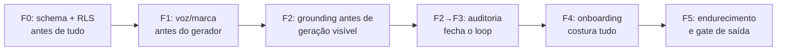

# Plano de Implementação Faseado

Este documento é o plano de execução do template do **Content Engine**: seis fases (F0–F5) que constroem o motor completo — do schema à validação final antes do primeiro Remix de cliente real. Ele traduz o escopo de 02-escopo-mvp.md e as prioridades de 03-features-priorizadas.md em épicos e tarefas de 0,5–2 dias, indicando para cada tarefa o canal de execução (Lovable MCP vs. frontend local + git push). O modelo de dados referenciado é o de 04-modelo-de-dados.md; rotas em 05-rotas-e-modulos.md; papéis de IA em 06-arquitetura-ia.md; contratos das edge functions em 07-contratos-backend.md; e a mecânica de Remix/atualização em 08-estrategia-template.md.

---

## 1. Visão geral das fases

| Fase | Nome | Objetivo | Entregáveis-chave | Critério de done | Depende de |
|------|------|----------|-------------------|------------------|------------|
| **F0** | Fundação | Banco, segurança e casca da aplicação prontos para tudo que vem depois | Migrations do schema completo (§6 do modelo) + RLS + triggers + seeds de fábrica; buckets; auth first-admin; extensões; tipos TS; layout `_app` + `/login` | Replay das migrations em banco vazio produz o schema completo; primeiro signup vira admin; login funciona com guards | — |
| **F1** | Cérebro da marca | Cliente consegue construir e navegar toda a identidade da marca e sua base de conhecimento | Telas `/marca/*` (CRUD versionado), módulo `/contexto` + `ingest-context` + busca híbrida, `store-secret` + `/config/ia` | **Marco M1**: cérebro da marca navegável (ver §5) | F0 |
| **F2** | Motor de geração | Comando livre vira peça auditada de ponta a ponta | `_shared/` completo (`llm.ts`, `funnel.ts`, `prompts/`, `linter.ts`, `grounding.ts`, `judge.ts`, `adapters/`), `generate-content` + `resume-job` + saga, `/criar` com Realtime, escolha de ângulo | **Marco M2**: primeira peça auditada gerada (ver §5) | F1 (voz/marca e contexto alimentam o gerador) |
| **F3** | Biblioteca e render | Peças viram entregáveis: revisão humana, aprovação e ativos finais | `/biblioteca`, chips de auditoria, aprovação, `regenerate-piece`, render tweet-card client-side, `generate-image`, dashboard `/` | Peça multi-canal aprovada na Biblioteca com PNG baixável e feedback gravado em `piece_feedback` | F2 |
| **F4** | Onboarding | O wizard costura F1–F3 numa jornada self-serve de primeira configuração | Wizard 9 passos retomável, `extract-voice`, `tone-gate`, `invite-user`, fechamento de signup | **Marco M3**: onboarding completo de ponta a ponta (ver §5) | F1 + F2 + F3 (o wizard reutiliza os módulos prontos) |
| **F5** | Endurecimento | Template pronto para o primeiro Remix de cliente real | Watchdog pg_cron, golden set, auditorias de RLS/endpoints/secrets, polish, runbook de Remix | Gate de saída do MVP aprovado + checklist de pronto do template (ver §8) 100% verde | F4 |

---

## 2. Caminho crítico

A ordem das fases não é arbitrária — cada elo destrava o seguinte:

1. **Schema/RLS antes de tudo (F0).** Toda tela e toda edge function dependem das tabelas e das policies. Corrigir RLS depois, com dados e código em cima, custa múltiplos do que custa agora.
2. **Voz/marca antes do gerador (F1).** O Gerador é uma função pura de `briefing + voz + contexto → core_content` (ver 06-arquitetura-ia.md); sem `brand_persona`, `brand_strategy` e `guardrails` ativos, não há o que gerar. O módulo de contexto precisa existir antes porque o RAG é insumo obrigatório.
3. **Grounding antes de geração visível (F2).** Nenhuma peça chega a `awaiting_review` sem passar pelo verificador de grounding — a regra "nunca inventar número/case" é inegociável e entra junto com o gerador, não depois.
4. **Auditoria fecha o loop (F2→F3).** Linter + grounding + juiz + reescrita ≤2 completam a saga; a Biblioteca (F3) só faz sentido exibindo peças já auditadas, com os diagnósticos virando chips.
5. **Onboarding costura (F4).** O wizard não constrói funcionalidades novas — ele orquestra módulos prontos (contexto, persona, guardrails, brand kit, canais, gate de tom). Construí-lo antes seria costurar peças que não existem.
6. **Endurecimento por último (F5).** Watchdog, golden set e auditorias só têm valor com o sistema completo rodando.

**Dentro de F2, o caminho crítico interno é**: `llm.ts` → `prompts/` + `funnel.ts` → gerador na saga → linter/grounding/judge → adapters → `/criar`. O linter (determinístico, sem LLM) pode ser desenvolvido em paralelo desde o início da fase.

---

## 3. Convenções de execução

Como o template vive num projeto Lovable com git sync (repo `MindOpsTeam/mega-automa-o-3.0`, branch `main` — **nunca reescrever histórico git**), cada tarefa se executa por um destes canais:

| Canal | Quando | Como |
|-------|--------|------|
| `lovable_query_sql` | Migrations (schema, RLS, seeds, funções SQL, pg_cron) | Escrever o arquivo em `supabase/migrations/` no repo (git push) **e** aplicar na instância template via Lovable MCP. O arquivo no repo é a fonte de verdade para o Remix (ver 08-estrategia-template.md); a aplicação via MCP mantém a instância template viva para desenvolvimento. Migrations sempre aditivas e idempotentes. |
| `lovable_deploy` | Edge functions e `_shared/` | Código em `supabase/functions/` no repo (git push) + deploy via Lovable MCP. Alterações em `_shared/` exigem redeploy das functions que as importam. |
| `lovable_create_bucket` | Buckets de storage | Criar os 3 buckets privados; policies de acesso via migration (`lovable_query_sql`). |
| `lovable_create_secrets` | Secrets de ambiente **apenas para desenvolvimento** (ex.: key Anthropic de teste do driver BYO) | Uso pontual em F2; **remoção obrigatória no checklist de F5** — secrets de cliente em produção entram exclusivamente pelo Supabase Vault via `store-secret` (proposta — validar). |
| Frontend local + git push | Rotas, componentes, hooks, estilos | Desenvolvimento local (Bun + Vite), commit e push na `main`; o git sync do Lovable propaga. |

---

## 4. Detalhamento por fase

Granularidade: 0,5–2 dias por tarefa. Estimativas em dias úteis de **uma pessoa operando com IA (ritmo Claude Code)** — já são estimativas aceleradas; não aplicar novo desconto sobre elas.

### F0 — Fundação (≈ 6,5 dias)

Objetivo: banco, segurança e casca da aplicação. Nada de feature visível além de login.

| ID | Tarefa | Execução | Est. |
|----|--------|----------|------|
| F0.1 | Migration de extensões e tipos: habilitar `vector`, `pg_cron`, `pg_net`; criar enums `app_role`, `channel_type`, `context_kind`, `job_status`, `piece_status` | `lovable_query_sql` | 0,5 d |
| F0.2 | Migration de identidade: `profiles`, `user_roles`, função `has_role()` SECURITY DEFINER, trigger `handle_new_user` (primeiro usuário vira admin, demais viram user) | `lovable_query_sql` | 0,5 d |
| F0.3 | Migration de marca e configuração: `app_settings`, `niche_templates`, `brand_persona`, `brand_strategy`, `guardrails`, `brand_kit`, `channels` + seeds de fábrica (4 templates de nicho: `criador-b2b`, `consultoria-financeira`, `clinica-saude`, `infoproduto`; 7 canais com defaults dos adapters) | `lovable_query_sql` | 1 d |
| F0.4 | Migration de contexto e geração: `context_items` (coluna gerada `search tsvector` português), `context_chunks` (`embedding vector(768)` + índice hnsw), `generation_jobs`, `content_pieces`, `piece_feedback`, `editorial_state` (tabela criada na F0; a feature de anti-repetição que a usa é P1 — ver 04-modelo-de-dados.md §6.12); publication Realtime com `generation_jobs` e `content_pieces` | `lovable_query_sql` | 1 d |
| F0.5 | Migration de RLS: policies em **todas** as tabelas — leitura autenticada onde couber, escrita admin em configuração, `created_by` onde couber; papéis sempre via `has_role()` | `lovable_query_sql` | 1 d |
| F0.6 | Buckets privados `context-files`, `brand-assets`, `renders` + policies de storage (signed URLs) | `lovable_create_bucket` + `lovable_query_sql` | 0,5 d |
| F0.7 | Geração de tipos TS do banco (`supabase gen types`) e integração nos clients existentes do scaffold (`client.ts`, `client.server.ts`) | frontend local + git push | 0,5 d |
| F0.8 | Rota `/login` (e-mail/senha), guards `beforeLoad` (sessão → redirect `/login`; role admin em `/config/*` e `/onboarding`; redirect de `_app` para `/onboarding` se incompleto — stub nesta fase), layout `_app` com sidebar shadcn e placeholders das rotas | frontend local + git push | 1,5 d |

**Critério de done de F0:**
- Replay das migrations em banco vazio produz o schema completo + seeds, sem erro e sem passo manual.
- Primeiro signup vira `admin` via `handle_new_user`; segundo signup vira `user`.
- RLS ativa em 100% das tabelas; usuário anônimo não lê nada.
- `/login` funcional; `_app` bloqueado sem sessão; tipos TS commitados.

### F1 — Cérebro da marca (≈ 10,5 dias)

Objetivo: o cliente consegue construir identidade, estratégia, guardrails, brand kit, canais e base de conhecimento — tudo navegável e versionado.

| ID | Tarefa | Execução | Est. |
|----|--------|----------|------|
| F1.1 | Infra de versionamento append-only no frontend: hook + componentes genéricos para o ciclo `draft → active → archived` (uma linha active), reutilizados por persona/strategy/guardrails/brand kit | frontend local + git push | 1 d |
| F1.2 | Hub `/marca` + `/marca/persona`: editor das 9 seções do contrato de voz (identity, credenciais, worldview/teses, tone_principles, signature_lexicon, calibration_heuristics, banlist-ref, opinioes, voice_checklist, reference_examples) | frontend local + git push | 1,5 d |
| F1.3 | `/marca/bandeira` (brand_promise, theses, enemy, safe_list, icp, editorial_stance, content_mix, cta_repertoire) + `/marca/guardrails` (ban lists, allowed_ctas, channel_scope_overrides, qa_rubric, approval_threshold, dosage_rules) | frontend local + git push | 1,5 d |
| F1.4 | `/marca/brand-kit` (paleta, tipografia, upload de logo/fotos para `brand-assets`) + `/marca/canais` (toggle por `channel_type` + overrides de config) | frontend local + git push | 1 d |
| F1.5 | Edge function `ingest-context` (limpeza → chunking → embeddings → `ready`/`error`) + primeira versão de `_shared/llm.ts` com driver `lovable-gateway` para embeddings (`google/gemini-embedding-001`) | `lovable_deploy` | 1,5 d |
| F1.6 | `/contexto` + `/contexto/$itemId`: cadastro (upload para `context-files`, colar texto, URL), kinds e tags, metadata tipada de `case` (metric_type, metric_value, client_name, sector, source_url, quote, objection_tags, citation_policy), status de ingestão, reprocessamento | frontend local + git push | 1,5 d |
| F1.7 | Busca híbrida: função SQL (pgvector cosine + tsvector português + filtros por kind/tags, ranking de cases por força da prova R$ > multiplicador > %) via migration + edge function `search-context` (reusa `_shared/retrieval.ts`; ver 07-contratos-backend.md) servindo a UI de busca em `/contexto` | `lovable_query_sql` + `lovable_deploy` + frontend | 1 d |
| F1.8 | Edge function `store-secret` + função SECURITY DEFINER restrita a admin gravando no Supabase Vault (nunca retorna valor) | `lovable_deploy` + `lovable_query_sql` | 0,5 d |
| F1.9 | Área `/config` (layout admin-only) + `/config/ia` (provider/modelo por papel em `app_settings`, cadastro de keys BYO via `store-secret`) + stub de `/config/integracoes` | frontend local + git push | 1 d |

**Critério de done de F1 = Marco M1** (ver §5).

### F2 — Motor de geração (≈ 13,5 dias)

Objetivo: comando livre entra, peça auditada sai. É a fase mais longa e de maior risco — concentra os prompts do motor e a máquina de estados.

| ID | Tarefa | Execução | Est. |
|----|--------|----------|------|
| F2.1 | `_shared/llm.ts` completo: interface `chat({role_hint, messages, schema?, stream?})` com 3 drivers — `lovable-gateway` (default), `anthropic` (prompt caching com prefixo estável + structured outputs) e `openai`; seleção por papel via `app_settings`; leitura de keys BYO do Vault via service role. Confirmar ID exato do modelo Flash do gateway (indicativo no brief). Key de teste do driver BYO via `lovable_create_secrets` (dev only) | `lovable_deploy` (+ `lovable_create_secrets` dev) | 2 d |
| F2.2 | `_shared/funnel.ts` (framework das 8 camadas como estrutura de dados + validações) e `_shared/prompts/` (roteador, gerador, juiz, extrator de voz — versionados com `ENGINE_VERSION`) | `lovable_deploy` | 1,5 d |
| F2.3 | `_shared/linter.ts` — Classe 1 determinística: pontuação banida, palavras banidas, emojis, hashtags fora de metadado, CTAs proibidos, limites do canal (via `lint_overrides` do adapter). Sem LLM; testável isoladamente | `lovable_deploy` | 1 d |
| F2.4 | `_shared/grounding.ts` — Classe 2: extração de números/citações do output, diff contra os `context_ids` selecionados, marcação `[VERIFICAR]` (registrada em `verify_flags`) em divergência, regra de 1 prova central (`proof`) por peça | `lovable_deploy` | 1,5 d |
| F2.5 | `_shared/judge.ts` — Classe 3: LLM-as-judge em chamada separada do gerador (`judge.verdict` `approve`/`rewrite` + `judge.score` 0–10), rubrica de 4 regras editoriais + arco completo + voz + nota de corte (`cutoff_score` por canal) | `lovable_deploy` | 1 d |
| F2.6 | `_shared/adapters/`: `base.ts` (contrato `ChannelAdapter`) + 7 adapters (`instagram_carousel`, `instagram_post`, `instagram_stories`, `x_post`, `threads_post`, `linkedin_post`, `facebook_post`) — `structure()` e `lint_overrides` nesta fase; `render_spec` consumido em F3 | `lovable_deploy` | 1,5 d |
| F2.7 | Edge function `generate-content`: cria `generation_jobs`, roda o Roteador (structured output `classification`: `format`, `channel_types`, `thesis`, `angles`, `context_query`), decide `awaiting_angle` (gatilho: `needs_angle_choice`) vs. disparo direto da saga | `lovable_deploy` | 1 d |
| F2.8 | Saga runner + edge function `resume-job`: máquina de estados `retrieving → generating → linting → grounding → judging → (rewriting ≤2) → adapting → awaiting_review`, resposta rápida com job id + processamento em background via `EdgeRuntime.waitUntil`, transições persistidas em `generation_jobs`, criação de `content_pieces` com versões carimbadas (persona/strategy/guardrails/brand kit/engine) | `lovable_deploy` | 2 d |
| F2.9 | Rota `/criar`: textarea de comando, jobs em andamento com acompanhamento em tempo real (Realtime em `generation_jobs`/`content_pieces` — publication já criada na F0 (F0.4); a F2 apenas consome via canal Realtime no `/criar`), escolha de ângulo inline (3–4 opções com hook → `resume-job`), estados de erro/cancelamento | frontend local + git push | 2 d |

**Critério de done de F2 = Marco M2** (ver §5).

### F3 — Biblioteca e render (≈ 8,5 dias)

Objetivo: fechar o ciclo humano — revisar, aprovar, regenerar e levar embora o ativo final.

| ID | Tarefa | Execução | Est. |
|----|--------|----------|------|
| F3.1 | `/biblioteca`: listagem de peças por status (`draft`, `approved`, `rejected`, `archived`), filtros por canal/job/data | frontend local + git push | 1 d |
| F3.2 | `/biblioteca/$pieceId`: preview por canal a partir de `adapted_content`, chips de auditoria a partir de `audit` jsonb (linter/grounding/judge com `verdict`, `score` e `diagnosis`), destaque de marcações `[VERIFICAR]` (`verify_flags`) para confirmação humana | frontend local + git push | 1,5 d |
| F3.3 | Aprovação/rejeição gravando em `piece_feedback` (verdict, notes, edited_diff) + copy/download de texto e ativos | frontend local + git push | 1 d |
| F3.4 | Edge function `regenerate-piece` ({piece_id, instruction}) + UI de regeneração guiada ("mais provocador", "encurta", instrução livre) | `lovable_deploy` + frontend | 1 d |
| F3.5 | Render tweet-card client-side determinístico: componente React + brand tokens → PNG (aspect ratios por adapter: 4:5, 1:1, 9:16 frames), upload para `renders`, `render_path` na peça | frontend local + git push | 2 d |
| F3.6 | Edge function `generate-image` ({piece_id \| image_brief}): imagem via gateway (`google/gemini-2.5-flash-image`), grava em `renders`; integração no preview e no fluxo do adapter (imagem opcional abaixo do texto) | `lovable_deploy` + frontend | 1 d |
| F3.7 | Dashboard `/` real: atalho de criação, últimas peças, estado da marca (versões ativas, canais habilitados, saúde da ingestão) | frontend local + git push | 1 d |

**Critério de done de F3:**
- Peça multi-canal navegável na Biblioteca com chips das 3 classes de auditoria.
- Aprovação/rejeição persiste em `piece_feedback`; regeneração guiada produz nova versão auditada.
- Tweet-card baixável como PNG fiel ao brand kit; imagem IA gerada e anexada quando o brief pede.

### F4 — Onboarding (≈ 10,5 dias)

Objetivo: a peça central do produto — o wizard self-serve que costura tudo que já existe. Máxima atenção a UX: é aqui que o produto se vende sozinho.

| ID | Tarefa | Execução | Est. |
|----|--------|----------|------|
| F4.1 | Shell do wizard `/onboarding`: layout próprio, guard admin, progresso persistido em `app_settings`, retomável em qualquer passo, redirect de `_app` quando mínimo viável (passos 3-4-5-6) incompleto | frontend local + git push | 1,5 d |
| F4.2 | Passo 1 `boas-vindas` (nome da marca + seleção de template de nicho / "começar em branco", aplicando presets de `niche_templates`) + Passo 2 `ia-e-integracoes` (gateway default zero-config; BYO keys opcional via `store-secret`) | frontend local + git push | 1 d |
| F4.3 | Passo 3 `contexto`: módulo `/contexto` embarcado no wizard (upload/cadastro inicial + ingestão) | frontend local + git push | 1 d |
| F4.4 | Edge function `extract-voice` ({context_item_ids[]}): corpus → rascunho das 9 seções via papel Extrator de Voz | `lovable_deploy` | 1 d |
| F4.5 | Passo 4 `voz`: extração assistida (chama `extract-voice`, humano aceita/edita seção a seção) + caminho alternativo de entrevista guiada sem corpus | frontend local + git push | 2 d |
| F4.6 | Passos 5 `bandeira`, 6 `guardrails`, 7 `brand-kit`, 8 `canais` — reuso das telas `/marca/*` em modo wizard (pré-populadas pelo template de nicho) | frontend local + git push | 1,5 d |
| F4.7 | Edge function `tone-gate` (reusa a saga com flag sample=true, 3 peças-amostra) + Passo 9 `gate-de-tom`: aprova/reprova por peça, reprovação volta ao passo de voz, vereditos gravados em `piece_feedback` para calibração futura e few-shot | `lovable_deploy` + frontend | 1,5 d |
| F4.8 | Edge function `invite-user` ({email, role}, via auth admin API) + `/config/usuarios` (convites, papéis) + fechamento do signup: aberto apenas enquanto não existe admin | `lovable_deploy` + frontend | 1 d |

**Critério de done de F4 = Marco M3** (ver §5).

### F5 — Endurecimento (≈ 7 dias)

Objetivo: transformar o sistema que funciona em template confiável para Remix.

| ID | Tarefa | Execução | Est. |
|----|--------|----------|------|
| F5.1 | Watchdog: job pg_cron que detecta `generation_jobs` travados (>N min sem update em estado intermediário) e re-invoca `resume-job` via pg_net; limite de tentativas → `failed` | `lovable_query_sql` | 1 d |
| F5.2 | Golden set: 3 briefs canônicos + script de smoke test que roda a saga completa e valida invariantes (estados percorridos, audit preenchido, zero alucinação de número) — base do processo de atualização de motor (ver 08-estrategia-template.md) | frontend local + git push (script no repo) | 1 d |
| F5.3 | Auditorias de segurança e correções: RLS (policies, `WITH CHECK`, escalada de papel), endpoints (verify_jwt, buckets, RPCs expostas), secrets (nada no bundle, nada residual, Vault ok), schema (PII, defaults). Ferramentas de execução: skills `lovable-rls-audit`, `lovable-endpoint-audit`, `lovable-secrets-audit`, `lovable-schema-audit` (proposta — validar o tooling; as auditorias em si são obrigatórias) | misto (`lovable_query_sql` p/ correções) | 1,5 d |
| F5.4 | Polish: estados vazios/loading/erro em todas as rotas, tratamento de 402 do gateway (créditos esgotados) com uso exposto em `/config`, `/config/instancia` (engine version, diagnóstico) e `/config/integracoes` finalizados | frontend local + git push | 1,5 d |
| F5.5 | Runbook de Remix + docs de operação: passo a passo do provisionamento, verificação pós-Remix, fallback manual se o Remix não replicar algo, registro no inventário de instâncias (planilha/CRM fora do produto) | frontend local + git push (docs no repo) | 1 d |
| F5.6 | Ensaio geral: Remix de teste do template → onboarding completo interpretando um cliente → gate de saída do MVP (peça multi-canal aprovada em <30 min de operação) → limpeza de resíduos do ensaio | misto | 1 d |

**Critério de done de F5:** checklist de pronto do template (§8) 100% verde + gate de saída do MVP aprovado.

---

## 5. Marcos de validação com o dono do produto

Três marcos síncronos (demo guiada de 30–60 min) + o gate final. Cada marco tem critérios objetivos — reprovou, a fase não fecha.

### M1 — fim de F1: cérebro da marca navegável

Roteiro da demo:
1. Editar a persona: criar draft, alterar seção, ativar nova versão — versão anterior arquivada.
2. Cadastrar um item de contexto por cada via (upload, colar texto, URL); acompanhar `processing → ready`.
3. Cadastrar um `case` com metadata tipada e encontrá-lo na busca híbrida por termo e por filtro (edge function `search-context`, ver 07-contratos-backend.md).
4. Gravar uma key BYO em `/config/ia` e demonstrar que o valor não aparece em nenhuma resposta ao client.

### M2 — fim de F2: primeira peça auditada gerada

Roteiro da demo:
1. Comando amplo em `/criar` → Roteador devolve 3–4 ângulos → escolher um → saga corre com estados visíveis em tempo real.
2. Peça chega a `awaiting_review` com `audit` completo (linter, grounding, judge com `verdict` e `score`).
3. Forçar uma reprovação do juiz (guardrail proposital) e demonstrar reescrita automática ≤2 + escalonamento.
4. Demonstrar um `[VERIFICAR]` (flag em `verify_flags`) gerado por número sem fonte no contexto.

### M3 — fim de F4: onboarding completo de ponta a ponta

Roteiro da demo (com banco resetado, simulando pós-Remix):
1. Signup do primeiro usuário → vira admin → cai no wizard.
2. Percorrer os 9 passos self-serve, incluindo extração assistida de voz e um retorno de reprovação no gate de tom.
3. Aprovar as 3 peças-amostra → `_app` liberado → gerar a primeira peça real.
4. Convidar um segundo usuário com papel `user` e verificar as restrições de acesso.

### Gate de saída do MVP — fim de F5

Cliente novo (simulado pelo dono do produto ou piloto real — validar) faz Remix → onboarding completo sozinho → 3 peças aprovadas no gate de tom → gera peça multi-canal aprovada em **<30 min de operação**.

---

## 6. Estimativa consolidada de esforço

Premissas: uma pessoa, dedicação integral, operando com IA em ritmo Claude Code (as estimativas por tarefa já embutem essa aceleração — o gargalo real é depuração de prompts, calibração de RAG/juiz e QA manual, não digitação de código).

| Fase | Estimativa base | Observação |
|------|----------------|------------|
| F0 Fundação | 6,5 d | Trabalho mecânico e bem especificado; menor incerteza |
| F1 Cérebro da marca | 10,5 d | Volume de telas; ingestão RAG é o item de maior incerteza |
| F2 Motor de geração | 13,5 d | Fase mais longa e de maior risco; prompts exigem iteração |
| F3 Biblioteca e render | 8,5 d | Render PNG fiel é o item de maior incerteza |
| F4 Onboarding | 10,5 d | Reuso alto, mas UX da peça central exige lapidação |
| F5 Endurecimento | 7 d | Auditorias podem gerar retrabalho (buffer cobre) |
| **Total base** | **56,5 d** | ≈ 11–12 semanas corridas |
| Buffer de execução (~15%) | +8,5 d | Depuração de prompts, regressões, imprevistos do Lovable |
| **Total planejado** | **≈ 65 d úteis** | **≈ 13 semanas** (proposta — validar contra a agenda) |

Sem paralelização possível (uma pessoa). Se houver pressão de prazo, o corte menos danoso é adiar F3.6 (`generate-image`), F3.7 (dashboard rico) e parte do polish de F5.4 — nunca cortar auditoria, grounding ou o gate de tom, que são a tese do produto (ver 01-visao-produto.md).

---

## 7. Riscos de execução por fase e plano B

| Fase | Risco principal | Sinal de alerta | Plano B |
|------|----------------|-----------------|---------|
| F0 | RLS mal desenhada descoberta tarde (retrabalho em cascata) | Policy que exige exceção já na F1 | Rodar a auditoria de RLS já no fim de F0 (antecipar parte de F5.3); correções sempre por migration aditiva |
| F1 | Ingestão/busca com relevância fraca (chunking ou embeddings mal calibrados) | Busca não encontra item recém-ingerido por termo óbvio | Começar com chunking simples por parágrafo; fallback temporário para full-text puro enquanto calibra o vetor; dimensão 768 fixada por migration desde F0 evita retrabalho |
| F1 | Complexidade do Vault (SECURITY DEFINER + service role) | Key legível por caminho não previsto | Congelar o acesso num único par `store-secret`/leitura server-side e auditar imediatamente (F1.8 inclui teste negativo) |
| F2 | Qualidade dos prompts do gerador/juiz abaixo do esperado | Peças genéricas ("poderia sair em qualquer perfil") passando do juiz | Nota de corte conservadora + aprovação humana obrigatória (já é o design); ativar driver `anthropic` BYO (`claude-sonnet-5`) para gerador e juiz se o gateway não entregar; vereditos em `piece_feedback` viram few-shot |
| F2 | Jobs longos × limites de execução de edge function | Jobs presos em estado intermediário | O design já fatia a saga por estado com `resume-job` re-invocável; antecipar o watchdog (F5.1) para dentro de F2 se travamentos aparecerem no desenvolvimento |
| F2 | Custo de tokens durante a iteração de prompts (402 do gateway) | Créditos do workspace esgotando em dev | Usar key BYO de desenvolvimento nas iterações pesadas; monitorar uso; cachear prefixos estáveis no driver `anthropic` |
| F3 | Fidelidade do render tweet-card client-side → PNG (fontes, layout, aspect ratios) | PNG divergente do preview | Fixar biblioteca de captura DOM→PNG cedo e testar nos 3 aspect ratios já em F3.5; se travar, MVP entrega copy/download de texto + imagem IA e o render entra logo após — sem bloquear o gate |
| F4 | Fricção no wizard (cliente não termina sozinho) | Testadores pedindo ajuda em algum passo | Templates de nicho pré-populando tudo + entrevista guiada sem corpus + persona manual como último recurso (mitigações já previstas); instrumentar o progresso em `app_settings` para achar o passo que trava |
| F4 | `extract-voice` fraco com corpus pequeno | Rascunho das 9 seções genérico | Caminho de entrevista guiada como alternativa de primeira classe (não fallback escondido); gate de tom pega o problema antes do cliente sofrer |
| F5 | Golden set revela regressão estrutural tarde | Brief canônico falhando em invariante | Rodar o golden set informalmente ao fim de F2 e F3 (não só em F5) — custo marginal baixo |
| F5 | Remix não replica tudo (migrations, functions, secrets, buckets) | Instância de ensaio nasce incompleta | Runbook manual de fallback com checklist de verificação pós-Remix (F5.5); o ensaio geral (F5.6) existe exatamente para pegar isso antes do cliente real |

---

## 8. Definição de pronto do template

Checklist final antes do **primeiro Remix de cliente real**. Tudo verde ou não há Remix.

### Código e repositório
- [ ] `main` limpa, git sync verde, histórico jamais reescrito.
- [ ] `ENGINE_VERSION` (semver) definida no código e carimbada em toda `content_pieces` gerada.
- [ ] Prompts do motor versionados em `_shared/prompts/` com `ENGINE_VERSION`.
- [ ] Nenhum dado de cliente, exemplo real ou referência a marca específica no código (a squad de origem é inspiração de método, nunca dependência).

### Banco
- [ ] Replay completo das migrations em banco vazio: schema §6 + seeds de fábrica (4 `niche_templates` + 7 `channels`), sem erro, idempotente.
- [ ] **Zero-resíduo**: nenhuma linha de recheio — sem persona, contexto, peças, jobs, feedback ou usuários de teste. Só dados de fábrica.
- [ ] Trigger `handle_new_user` validado: primeiro signup vira admin.
- [ ] Extensões `vector`, `pg_cron` (e `pg_net` se o watchdog usar) habilitadas por migration.
- [ ] Job do watchdog agendado e testado (job travado artificialmente é retomado).

### Segurança (auditorias obrigatórias)
- [ ] **Auditoria de RLS**: 100% das tabelas com RLS; policies com `WITH CHECK`; nenhum caminho de escalada de papel (papéis só via `user_roles` + `has_role()`, nunca coluna em `profiles`); sem `SECURITY DEFINER` que vaze.
- [ ] **Auditoria de endpoints**: todas as edge functions com `verify_jwt=true`; endpoints admin (`store-secret`, `invite-user`) checando role admin no corpo da função; buckets 100% privados (signed URLs); nenhuma RPC sensível exposta ao `anon`.
- [ ] **Auditoria de secrets**: nenhuma key no bundle do client; nenhum secret de teste residual na instância template (conferir via listagem de secrets); Vault sem dados de desenvolvimento; `LOVABLE_API_KEY` apenas via ambiente da function.
- [ ] **Auditoria de schema**: sem PII exposta, defaults seguros, FKs íntegras.

### Produto
- [ ] Signup aberto apenas enquanto não existe admin; depois, somente convite.
- [ ] Onboarding retomável em qualquer passo; mínimo viável (passos 3-4-5-6) destrava a geração; gate de tom funcional com vereditos persistidos.
- [ ] Golden set (3 briefs canônicos) passando na instância template.
- [ ] Tratamento de 402 do gateway visível ao cliente em `/config`.

### Operação
- [ ] Ensaio geral aprovado: Remix de teste → onboarding self-serve completo → gate de saída do MVP em <30 min.
- [ ] Runbook de Remix publicado (provisionamento, verificação pós-Remix, fallback manual).
- [ ] Instância de ensaio registrada e depois removida; inventário de instâncias (planilha/CRM externo) criado com o template registrado.

Cumprido este checklist, o template está pronto para a estratégia de distribuição descrita em 08-estrategia-template.md — e cada novo cliente passa a ser um Remix, um signup e um onboarding.
